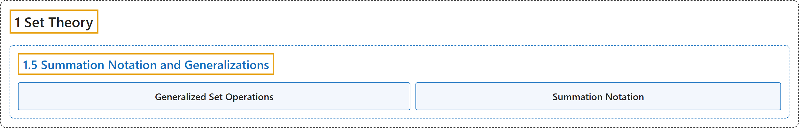

# 1.5 Summation Notation and Generalizations

## Classification

## Glossary

| Term | Definition | 中文翻译 | Source |
|---|---|---|---|
| **1.5 Summation Notation and Generalizations** 求和记号及其推广 | (No definition) | （无定义） | [Doerr & Levasseur, n.d., section 1.5](https://discretemath.org/ads/s-summation_Notation_and_Generalizations.html) |
| **Generalized Set Operations** 广义集合运算 | "**Let $A_1, A_2, \ldots, A_n$ be sets**. Then:" | 设 $A_1, A_2, \ldots, A_n$ 是**集合**。则： | [Doerr & Levasseur, n.d., Definition 1.5.3](https://discretemath.org/ads/s-summation_Notation_and_Generalizations.html#generalized-set-operations) |
| **Summation Notation** 求和记号 | "A sum of numbers such as $a_1+a_2+a_3+a_4$ is called a **series** and is often written $\sum_{k=1}^4 a_k$ in what is called **summation notation**." | 形如 $a_1+a_2+a_3+a_4$ 的若干数之和称为**级数**，常写作 $\sum_{k=1}^4 a_k$，这种写法称为**求和记号**。 | [Doerr & Levasseur, n.d., section 1.5](https://discretemath.org/ads/s-summation_Notation_and_Generalizations.html#ss-sums-2) |

## References

Doerr, A., & Levasseur, K. (n.d.). *Applied discrete structures*. Retrieved October 28, 2026, from <https://discretemath.org/ads/index-ads.html>
