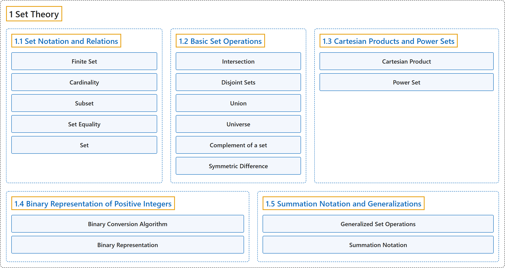

# 1 Set Theory

## Classification

## Glossary

| Term | Definition | 中文翻译 | Source |
|---|---|---|---|
| **1 Set Theory** 集合论 | (No definition) | （无定义） | [Doerr & Levasseur, n.d., chapter 1](https://discretemath.org/ads/chapter_1.html) |
| **[1.1 Set Notation and Relations](1-1-set-notation-and-relations.md)** 集合记号与关系 | (No definition) | （无定义） | [Doerr & Levasseur, n.d., section 1.1](https://discretemath.org/ads/s-set-Notation-and-Relations.html) |
| **[1.2 Basic Set Operations](1-2-basic-set-operations.md)** 集合的基本运算 | (No definition) | （无定义） | [Doerr & Levasseur, n.d., section 1.2](https://discretemath.org/ads/s-basic_Set_Operations.html) |
| **[1.3 Cartesian Products and Power Sets](1-3-cartesian-products-and-power-sets.md)** 笛卡儿积与幂集 | (No definition) | （无定义） | [Doerr & Levasseur, n.d., section 1.3](https://discretemath.org/ads/s-cartesian_Products_and_Power_Sets.html) |
| **[1.4 Binary Representation of Positive Integers](1-4-binary-representation-of-positive-integers.md)** 正整数的二进制表示 | (No definition) | （无定义） | [Doerr & Levasseur, n.d., section 1.4](https://discretemath.org/ads/s-binary_Representation_of_Positive_Integers.html) |
| **[1.5 Summation Notation and Generalizations](1-5-summation-notation-and-generalizations.md)** 求和记号及其推广 | (No definition) | （无定义） | [Doerr & Levasseur, n.d., section 1.5](https://discretemath.org/ads/s-summation_Notation_and_Generalizations.html) |

## References

Doerr, A., & Levasseur, K. (n.d.). *Applied discrete structures*. Retrieved October 28, 2026, from <https://discretemath.org/ads/index-ads.html>
