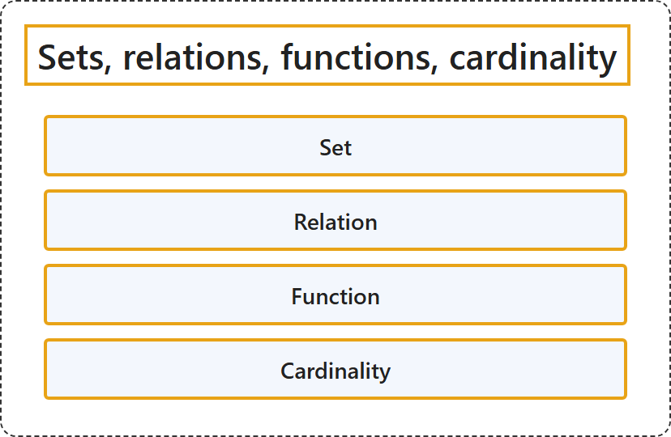

# 1.1 Sets, relations, functions, cardinality

Tier: CS Core.

## Classification

## Glossary

| Term | Definition | 中文翻译 | Source |
|---|---|---|---|
| **Set** 集合 | "A set is a finite or infinite **collection of objects** in which **order has no significance**, and multiplicity is generally also ignored (unlike a list or multiset)." | 集合是有限或无限的**对象的汇集**，其中**顺序没有意义**，重复次数通常也被忽略（不同于列表或多重集）。 | [Weisstein, n.d.-d, "Set" entry, para. 1](https://mathworld.wolfram.com/Set.html#:~:text=A%20set%20is%20a%20finite%20or%20infinite%20collection%20of%20objects) |
| **Relation** 关系 | "A relation is **any subset of a Cartesian product**." | 关系是**笛卡儿积的任意子集**。 | [Weisstein, n.d.-c, "Relation" entry, para. 1](https://mathworld.wolfram.com/Relation.html#:~:text=A%20relation%20is%20any%20subset%20of%20a%20Cartesian%20product) |
| **Function** 函数 | "A function is a relation that **uniquely associates members of one set** with **members of another set**." | 函数是一种关系，它把**一个集合的成员唯一地对应**到**另一个集合的成员**。 | [Weisstein, n.d.-b, "Function" entry, para. 1](https://mathworld.wolfram.com/Function.html#:~:text=A%20function%20is%20a%20relation%20that%20uniquely%20associates%20members%20of%20one%20set) |
| **Cardinality** 基数 | "In formal set theory, a cardinal number (also called 'the cardinality') is a **type of number** defined in such a way that **any method of counting sets using it gives the same result**." | 在形式集合论中，基数（也称为 cardinality）是一种**数的类型**，它的定义方式保证**用它计数集合的任何方法都得到相同的结果**。 | [Weisstein, n.d.-a, "Cardinal number" entry, para. 2](https://mathworld.wolfram.com/CardinalNumber.html#:~:text=is%20a%20type%20of%20number%20defined%20in%20such%20a%20way%20that%20any%20method%20of%20counting%20sets) |

## References

- Joint Task Force on Computing Curricula. (2024). *Computer science curricula 2023*. Association for Computing Machinery. <https://doi.org/10.1145/3664191>
- Weisstein, E. W. (n.d.-a). *Cardinal number*. MathWorld: A Wolfram Resource. Retrieved October 27, 2026, from <https://mathworld.wolfram.com/CardinalNumber.html>
- Weisstein, E. W. (n.d.-b). *Function*. MathWorld: A Wolfram Resource. Retrieved October 27, 2026, from <https://mathworld.wolfram.com/Function.html>
- Weisstein, E. W. (n.d.-c). *Relation*. MathWorld: A Wolfram Resource. Retrieved October 27, 2026, from <https://mathworld.wolfram.com/Relation.html>
- Weisstein, E. W. (n.d.-d). *Set*. MathWorld: A Wolfram Resource. Retrieved October 27, 2026, from <https://mathworld.wolfram.com/Set.html>
