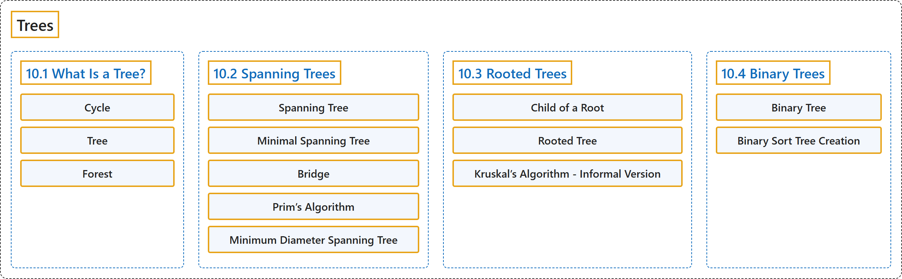

# 10 Trees

## Classification

## Glossary

| Term | Definition | 中文翻译 | Source |
|---|---|---|---|
| **10 Trees** 树 | (No definition) | （无定义） | [Doerr & Levasseur, n.d., chapter 10](https://discretemath.org/ads/chapter_10.html) |
| **10.1 What Is a Tree?** 什么是树？ | (No definition) | （无定义） | [Doerr & Levasseur, n.d., section 10.1](https://discretemath.org/ads/s-what-is-a-tree.html) |
| **Cycle** 圈 | "A **cycle** is **a circuit whose edge list contains no duplicates**. It is customary to use $C_n$ to denote a cycle with $n$ edges." | **圈**是**边表不含重复的回路**。习惯上用 $C_n$ 表示有 $n$ 条边的圈。 | [Doerr & Levasseur, n.d., Definition 10.1.1](https://discretemath.org/ads/s-what-is-a-tree.html#def-cycle) |
| **Tree** 树 | "A tree is a **finite simple graph** with at least one graph vertex that is **undirected, connected, and acyclic** (or, equivalently, a connected forest)." | 树是至少有一个顶点的**有限简单图**，它**无向、连通且无环**（等价地说，是一个连通的森林）。 | [Weisstein, n.d.-b, "Tree" entry, para. 1](https://mathworld.wolfram.com/Tree.html#:~:text=A%20tree%20is%20a%20finite%20simple%20graph) |
| **Forest** 森林 | "A **forest** is **an undirected graph whose components are all trees**." | **森林**是**各分量都是树的无向图**。 | [Doerr & Levasseur, n.d., Definition 10.1.8](https://discretemath.org/ads/s-what-is-a-tree.html#def-forest) |
| **10.2 Spanning Trees** 生成树 | (No definition) | （无定义） | [Doerr & Levasseur, n.d., section 10.2](https://discretemath.org/ads/s-spanning-trees.html) |
| **Spanning Tree** 生成树 | "Let $G = (V, E)$ be a connected undirected graph. A **spanning tree** for $G$ is **a spanning subgraph** 9.1.17 of $G$ that is a tree." | 设 $G = (V, E)$ 为连通无向图。$G$ 的**生成树**是 $G$ 的**生成子图** 9.1.17，且是一棵树。 | [Doerr & Levasseur, n.d., Definition 10.2.2](https://discretemath.org/ads/s-spanning-trees.html#def-spanning-tree) |
| **Minimal Spanning Tree** 最小生成树 | "Given a weighted connected undirected graph $G = (V, E, w)\text{,}$ a **minimal spanning tree** is **a spanning tree** $(V, E')$ for which $\sum_{e\in E'} w(e)$ is as small as possible." | 给定带权连通无向图 $G = (V, E, w)$，**最小生成树**是**生成树** $(V, E')$，其 $\sum_{e\in E'} w(e)$ 尽可能小。 | [Doerr & Levasseur, n.d., Definition 10.2.4](https://discretemath.org/ads/s-spanning-trees.html#def-min-spanning-tree) |
| **Bridge** 桥 | "Let $G = (V, E)$ be an undirected graph and let $\{L, R\}$ be a partition of $V\text{.}$ A **bridge** between $L$ and $R$ is **an edge in $E$ that connects a vertex in $L$ to a vertex in $R\text{.}$**" | 设 $G = (V, E)$ 为无向图，$\{L, R\}$ 为 $V$。 的划分。$L$ 与 $R$ 之间的**桥**是 $E$ 中**连接 $L$ 中一个顶点与 $R$ 中一个顶点的边**。 | [Doerr & Levasseur, n.d., Definition 10.2.5](https://discretemath.org/ads/s-spanning-trees.html#def-bridge) |
| **Prim’s Algorithm** Prim 算法 | "Let $G = (V, E, w)$ be a connected, weighted, undirected graph, and let $v_0$ be an arbitrary vertex in $V\text{.}$ The following steps lead to a **minimal spanning tree** for $G\text{.}$ $L$ and $R$ will be sets of vertices and $E'$ is a set of edges." | 设 $G = (V, E, w)$ 为连通带权无向图，$v_0$ 为 $V$。 中任意一个顶点。下列步骤可得到 $G$。 的**最小生成树**。$L$ 和 $R$ 是顶点集，$E'$ 是边集。 | [Doerr & Levasseur, n.d., Algorithm 10.2.9](https://discretemath.org/ads/s-spanning-trees.html#alg-prim) |
| **Minimum Diameter Spanning Tree** 最小直径生成树 | "Given a connected undirected graph $G = (V, E)\text{,}$ find a **spanning tree $T = (V, E')$ of $G$ such that the longest path in $T$ is as short as possible**. A solution to this problem is relatively easy to obtain by combining the idea the center of a graph with the breadth first search." | 给定连通无向图 $G = (V, E)$，求 $G$ 的**生成树 $T = (V, E')$，使得 $T$ 中最长的路径尽可能短**。把图的中心的概念与广度优先搜索结合起来，就比较容易得到该问题的解。 | [Doerr & Levasseur, n.d., Definition 10.2.14](https://discretemath.org/ads/s-spanning-trees.html#def-min-diameter-spanning-tree) |
| **10.3 Rooted Trees** 根树 | (No definition) | （无定义） | [Doerr & Levasseur, n.d., section 10.3](https://discretemath.org/ads/s-rooted-trees.html) |
| **Child of a Root** 根的孩子 | "Given a rooted tree with root $v\text{,}$ a **child of $v$** is **a vertex that is connected to $v$ by an edge of the tree**. We refer to the root as the **parent** of each of its children." | 给定根为 $v$ 的根树，$v$ 的**子节点**是**通过树的一条边与 $v$ 相连的顶点**。我们称根为它的每个子节点的**父节点**。 | [Doerr & Levasseur, n.d., Definition 10.3.4](https://discretemath.org/ads/s-rooted-trees.html#def-child-of-root) |
| **Rooted Tree** 根树 | "A **single vertex $v$ with no children is a rooted tree with root $v\text{.}$**" | **没有子节点的单个顶点 $v$ 是以 $v$ 为根的根树**。 | [Doerr & Levasseur, n.d., Definition 10.3.5](https://discretemath.org/ads/s-rooted-trees.html#def-rooted-tree) |
| **Kruskal’s Algorithm - Informal Version** Kruskal 算法（非形式化版本） | "**Sort the edges of $G$ in ascending order according to weight**. That is," | **按权从小到大对 $G$ 的边排序**。即， | [Doerr & Levasseur, n.d., Algorithm 10.3.9](https://discretemath.org/ads/s-rooted-trees.html#ss-kruskal-algorithm-3) |
| **10.4 Binary Trees** 二叉树 | (No definition) | （无定义） | [Doerr & Levasseur, n.d., section 10.4](https://discretemath.org/ads/s-binary-trees.html) |
| **Binary Tree** 二叉树 | "A **tree consisting of no vertices (the empty tree) is a binary tree**." | **不含顶点的树（空树）是二叉树**。 | [Doerr & Levasseur, n.d., Definition 10.4.3](https://discretemath.org/ads/s-binary-trees.html#def-binary-tree) |
| **Binary Sort Tree Creation** 二叉排序树的创建 | "**Insert $a_1$ into the root of the tree**." | **把 $a_1$ 插入树的根**。 | [Doerr & Levasseur, n.d., Algorithm 10.4.8](https://discretemath.org/ads/s-binary-trees.html#alg-bin-sort-maketree) |

## References

Doerr, A., & Levasseur, K. (n.d.). *Applied discrete structures*. Retrieved October 28, 2026, from <https://discretemath.org/ads/index-ads.html>

Weisstein, E. W. (n.d.-b). *Tree*. MathWorld: A Wolfram Resource. Retrieved October 27, 2026, from <https://mathworld.wolfram.com/Tree.html>
