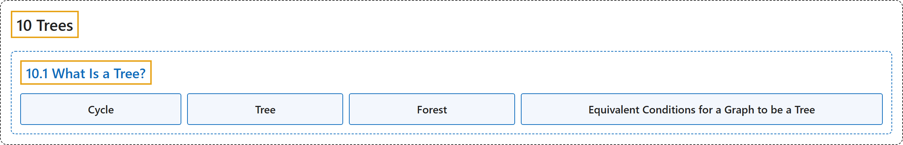

# 10.1 What Is a Tree?

## Classification

## Glossary

| Term | Definition | 中文翻译 | Source |
|---|---|---|---|
| **10.1 What Is a Tree?** 什么是树？ | (No definition) | （无定义） | [Doerr & Levasseur, n.d., section 10.1](https://discretemath.org/ads/s-what-is-a-tree.html) |
| **Cycle** 圈 | "A **cycle** is **a circuit whose edge list contains no duplicates**. It is customary to use $C_n$ to denote a cycle with $n$ edges." | **圈**是**边表不含重复的回路**。习惯上用 $C_n$ 表示有 $n$ 条边的圈。 | [Doerr & Levasseur, n.d., Definition 10.1.1](https://discretemath.org/ads/s-what-is-a-tree.html#def-cycle) |
| **Tree** 树 | "A tree is a **finite simple graph** with at least one graph vertex that is **undirected, connected, and acyclic** (or, equivalently, a connected forest)." | 树是至少有一个顶点的**有限简单图**，它**无向、连通且无环**（等价地说，是一个连通的森林）。 | [Weisstein, n.d.-b, "Tree" entry, para. 1](https://mathworld.wolfram.com/Tree.html#:~:text=A%20tree%20is%20a%20finite%20simple%20graph) |
| **Forest** 森林 | "A **forest** is **an undirected graph whose components are all trees**." | **森林**是**各分量都是树的无向图**。 | [Doerr & Levasseur, n.d., Definition 10.1.8](https://discretemath.org/ads/s-what-is-a-tree.html#def-forest) |
| **Equivalent Conditions for a Graph to be a Tree** 图为树的等价条件 | "Let $G = (V, E)$ be an undirected graph with no self-loops and $\lvert V \rvert =n$. **The following are all equivalent**: $G$ is a tree. For each pair of distinct vertices in $V$, there exists a unique simple path between them. $G$ is connected, and if $e\in E$, then $(V, E-\{e\})$ is disconnected. $G$ contains no cycles, but by adding one edge, you create a cycle. $G$ is connected and $\lvert E \rvert =n-1$." | 设 $G = (V, E)$ 是没有自环的无向图，且 $\lvert V \rvert =n$。**以下各条全都等价**：$G$ 是树。对 $V$ 中每一对不同的顶点，它们之间存在唯一的简单路径。$G$ 是连通的，并且若 $e\in E$，则 $(V, E-\{e\})$ 不连通。$G$ 不含圈，但加上一条边就会产生一个圈。$G$ 是连通的且 $\lvert E \rvert =n-1$。 | [Doerr & Levasseur, n.d., Theorem 10.1.11](https://discretemath.org/ads/s-what-is-a-tree.html#theorem-tree-conditions) |

## References

Doerr, A., & Levasseur, K. (n.d.). *Applied discrete structures*. Retrieved October 28, 2026, from <https://discretemath.org/ads/index-ads.html>

Weisstein, E. W. (n.d.-b). *Tree*. MathWorld: A Wolfram Resource. Retrieved October 27, 2026, from <https://mathworld.wolfram.com/Tree.html>
