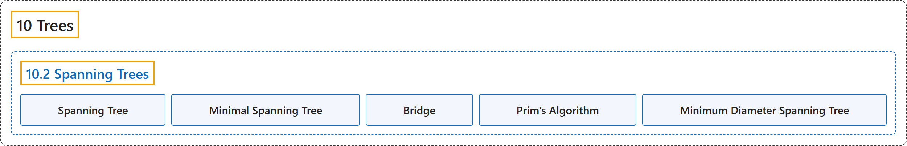

# 10.2 Spanning Trees

## Classification

## Glossary

| Term | Definition | 中文翻译 | Source |
|---|---|---|---|
| **10.2 Spanning Trees** 生成树 | (No definition) | （无定义） | [Doerr & Levasseur, n.d., section 10.2](https://discretemath.org/ads/s-spanning-trees.html) |
| **Spanning Tree** 生成树 | "Let $G = (V, E)$ be a connected undirected graph. A **spanning tree** for $G$ is **a spanning subgraph** 9.1.17 of $G$ that is a tree." | 设 $G = (V, E)$ 为连通无向图。$G$ 的**生成树**是 $G$ 的**生成子图** 9.1.17，且是一棵树。 | [Doerr & Levasseur, n.d., Definition 10.2.2](https://discretemath.org/ads/s-spanning-trees.html#def-spanning-tree) |
| **Minimal Spanning Tree** 最小生成树 | "Given a weighted connected undirected graph $G = (V, E, w)\text{,}$ a **minimal spanning tree** is **a spanning tree** $(V, E')$ for which $\sum_{e\in E'} w(e)$ is as small as possible." | 给定带权连通无向图 $G = (V, E, w)$，**最小生成树**是**生成树** $(V, E')$，其 $\sum_{e\in E'} w(e)$ 尽可能小。 | [Doerr & Levasseur, n.d., Definition 10.2.4](https://discretemath.org/ads/s-spanning-trees.html#def-min-spanning-tree) |
| **Bridge** 桥 | "Let $G = (V, E)$ be an undirected graph and let $\{L, R\}$ be a partition of $V\text{.}$ A **bridge** between $L$ and $R$ is **an edge in $E$ that connects a vertex in $L$ to a vertex in $R\text{.}$**" | 设 $G = (V, E)$ 为无向图，$\{L, R\}$ 为 $V$。 的划分。$L$ 与 $R$ 之间的**桥**是 $E$ 中**连接 $L$ 中一个顶点与 $R$ 中一个顶点的边**。 | [Doerr & Levasseur, n.d., Definition 10.2.5](https://discretemath.org/ads/s-spanning-trees.html#def-bridge) |
| **Prim’s Algorithm** Prim 算法 | "Let $G = (V, E, w)$ be a connected, weighted, undirected graph, and let $v_0$ be an arbitrary vertex in $V\text{.}$ The following steps lead to a **minimal spanning tree** for $G\text{.}$ $L$ and $R$ will be sets of vertices and $E'$ is a set of edges." | 设 $G = (V, E, w)$ 为连通带权无向图，$v_0$ 为 $V$。 中任意一个顶点。下列步骤可得到 $G$。 的**最小生成树**。$L$ 和 $R$ 是顶点集，$E'$ 是边集。 | [Doerr & Levasseur, n.d., Algorithm 10.2.9](https://discretemath.org/ads/s-spanning-trees.html#alg-prim) |
| **Minimum Diameter Spanning Tree** 最小直径生成树 | "Given a connected undirected graph $G = (V, E)\text{,}$ find a **spanning tree $T = (V, E')$ of $G$ such that the longest path in $T$ is as short as possible**. A solution to this problem is relatively easy to obtain by combining the idea the center of a graph with the breadth first search." | 给定连通无向图 $G = (V, E)$，求 $G$ 的**生成树 $T = (V, E')$，使得 $T$ 中最长的路径尽可能短**。把图的中心的概念与广度优先搜索结合起来，就比较容易得到该问题的解。 | [Doerr & Levasseur, n.d., Definition 10.2.14](https://discretemath.org/ads/s-spanning-trees.html#def-min-diameter-spanning-tree) |

## References

Doerr, A., & Levasseur, K. (n.d.). *Applied discrete structures*. Retrieved October 28, 2026, from <https://discretemath.org/ads/index-ads.html>
