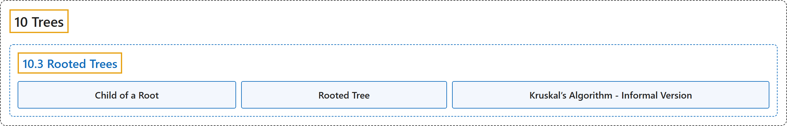

# 10.3 Rooted Trees

## Classification

## Glossary

| Term | Definition | 中文翻译 | Source |
|---|---|---|---|
| **10.3 Rooted Trees** 根树 | (No definition) | （无定义） | [Doerr & Levasseur, n.d., section 10.3](https://discretemath.org/ads/s-rooted-trees.html) |
| **Child of a Root** 根的孩子 | "Given a rooted tree with root $v\text{,}$ a **child of $v$** is **a vertex that is connected to $v$ by an edge of the tree**. We refer to the root as the **parent** of each of its children." | 给定根为 $v$ 的根树，$v$ 的**子节点**是**通过树的一条边与 $v$ 相连的顶点**。我们称根为它的每个子节点的**父节点**。 | [Doerr & Levasseur, n.d., Definition 10.3.4](https://discretemath.org/ads/s-rooted-trees.html#def-child-of-root) |
| **Rooted Tree** 根树 | "A **single vertex $v$ with no children is a rooted tree with root $v\text{.}$**" | **没有子节点的单个顶点 $v$ 是以 $v$ 为根的根树**。 | [Doerr & Levasseur, n.d., Definition 10.3.5](https://discretemath.org/ads/s-rooted-trees.html#def-rooted-tree) |
| **Kruskal’s Algorithm - Informal Version** Kruskal 算法（非形式化版本） | "**Sort the edges of $G$ in ascending order according to weight**. That is," | **按权从小到大对 $G$ 的边排序**。即， | [Doerr & Levasseur, n.d., Algorithm 10.3.9](https://discretemath.org/ads/s-rooted-trees.html#ss-kruskal-algorithm-3) |

## References

Doerr, A., & Levasseur, K. (n.d.). *Applied discrete structures*. Retrieved October 28, 2026, from <https://discretemath.org/ads/index-ads.html>
