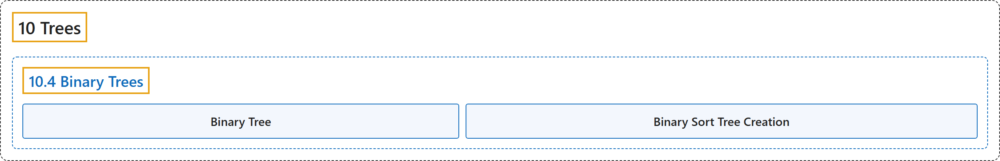

# 10.4 Binary Trees

## Classification

## Glossary

| Term | Definition | 中文翻译 | Source |
|---|---|---|---|
| **10.4 Binary Trees** 二叉树 | (No definition) | （无定义） | [Doerr & Levasseur, n.d., section 10.4](https://discretemath.org/ads/s-binary-trees.html) |
| **Binary Tree** 二叉树 | "A **tree consisting of no vertices (the empty tree) is a binary tree**." | **不含顶点的树（空树）是二叉树**。 | [Doerr & Levasseur, n.d., Definition 10.4.3](https://discretemath.org/ads/s-binary-trees.html#def-binary-tree) |
| **Binary Sort Tree Creation** 二叉排序树的创建 | "**Insert $a_1$ into the root of the tree**." | **把 $a_1$ 插入树的根**。 | [Doerr & Levasseur, n.d., Algorithm 10.4.8](https://discretemath.org/ads/s-binary-trees.html#alg-bin-sort-maketree) |

## References

Doerr, A., & Levasseur, K. (n.d.). *Applied discrete structures*. Retrieved October 28, 2026, from <https://discretemath.org/ads/index-ads.html>
