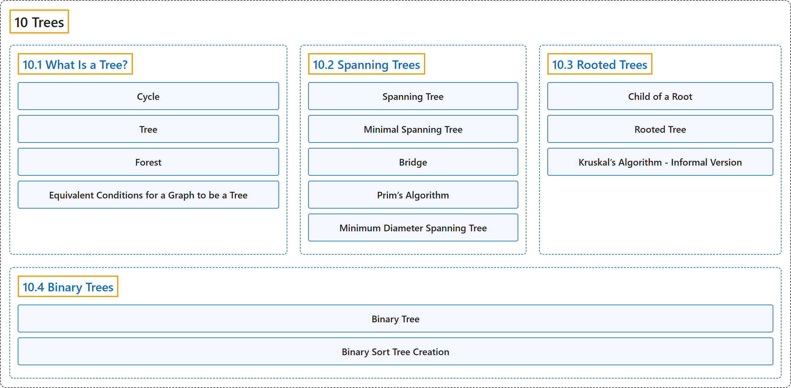

# 10 Trees

## Classification

## Glossary

| Term | Definition | 中文翻译 | Source |
|---|---|---|---|
| **10 Trees** 树 | (No definition) | （无定义） | [Doerr & Levasseur, n.d., chapter 10](https://discretemath.org/ads/chapter_10.html) |
| **[10.1 What Is a Tree?](10-1-what-is-a-tree.md)** 什么是树？ | (No definition) | （无定义） | [Doerr & Levasseur, n.d., section 10.1](https://discretemath.org/ads/s-what-is-a-tree.html) |
| **[10.2 Spanning Trees](10-2-spanning-trees.md)** 生成树 | (No definition) | （无定义） | [Doerr & Levasseur, n.d., section 10.2](https://discretemath.org/ads/s-spanning-trees.html) |
| **[10.3 Rooted Trees](10-3-rooted-trees.md)** 根树 | (No definition) | （无定义） | [Doerr & Levasseur, n.d., section 10.3](https://discretemath.org/ads/s-rooted-trees.html) |
| **[10.4 Binary Trees](10-4-binary-trees.md)** 二叉树 | (No definition) | （无定义） | [Doerr & Levasseur, n.d., section 10.4](https://discretemath.org/ads/s-binary-trees.html) |

## References

Doerr, A., & Levasseur, K. (n.d.). *Applied discrete structures*. Retrieved October 28, 2026, from <https://discretemath.org/ads/index-ads.html>
