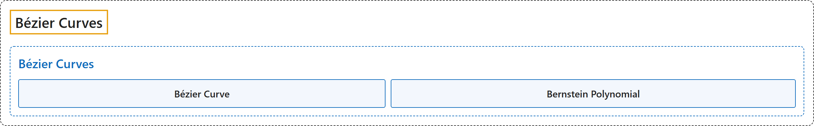

# 8 Bézier Curves

## Classification

## Glossary

| Term | Definition | 中文翻译 | Source |
|---|---|---|---|
| **8 Bézier Curves** 贝塞尔曲线 | (No definition) | （无定义） | [Weisstein, n.d.-a](https://mathworld.wolfram.com/BezierCurve.html) |
| **Bézier Curve** 贝塞尔曲线 | "Given a set of $n+1$ **control points** $P_0$, $P_1$, ..., $P_n$, the corresponding **Bézier curve** (or Bernstein-Bézier curve) is given by …" | 给定 $n+1$ 个**控制点** $P_0$、$P_1$、...、$P_n$，相应的**贝塞尔曲线**（或伯恩斯坦-贝塞尔曲线）由下式给出… | [Weisstein, n.d.-a, "Bézier curve" entry, para. 1](https://mathworld.wolfram.com/BezierCurve.html#:~:text=the%20corresponding%20B%C3%A9zier%20curve) |
| **Bernstein Polynomial** 伯恩斯坦多项式 | (context) "The Bernstein polynomials of degree n **form a basis** for the **power polynomials of degree n**." | （语境）n 次伯恩斯坦多项式**构成一组基**，用于表示 **n 次幂多项式**。 | [Weisstein, n.d.-b, "Bernstein polynomial" entry, para. 2](https://mathworld.wolfram.com/BernsteinPolynomial.html#:~:text=form%20a%20basis%20for%20the%20power%20polynomials) |

## References

Weisstein, E. W. (n.d.-a). *Bézier curve*. MathWorld: A Wolfram Resource. Retrieved October 29, 2026, from <https://mathworld.wolfram.com/BezierCurve.html>

Weisstein, E. W. (n.d.-b). *Bernstein polynomial*. MathWorld: A Wolfram Resource. Retrieved October 27, 2026, from <https://mathworld.wolfram.com/BernsteinPolynomial.html>
