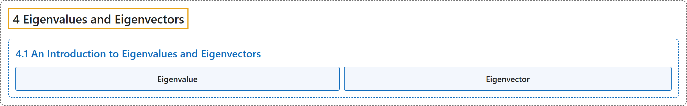

# 4.1 An Introduction to Eigenvalues and Eigenvectors

## Classification

## Glossary

| Term | Definition | 中文翻译 | Source |
|---|---|---|---|
| **4.1 An Introduction to Eigenvalues and Eigenvectors** 特征值与特征向量介绍 | (No definition) | （无定义） | [Austin, 2023, section 4.1](https://understandinglinearalgebra.org/sec-eigen-intro.html) |
| **Eigenvalue** 特征值 | "The scalar $\lambda$ is called the **eigenvalue associated to the eigenvector $\mathbf{v}$**." | 标量 $\lambda$ 称为**与特征向量 $\mathbf{v}$ 对应的特征值**。 | [Austin, 2023, Definition 4.1.2](https://understandinglinearalgebra.org/sec-eigen-intro.html#definition-eigenvectors) |
| **Eigenvector** 特征向量 | "Given a square $n\times n$ matrix $A$, we say that a **nonzero vector $\mathbf{v}$** is an **eigenvector** of $A$ if **there is a scalar $\lambda$ such that $A\mathbf{v} = \lambda \mathbf{v}$**." | 给定 $n\times n$ 方阵 $A$，如果对**非零向量 $\mathbf{v}$**，**存在标量 $\lambda$ 使得 $A\mathbf{v} = \lambda \mathbf{v}$**，就称 $\mathbf{v}$ 是 $A$ 的**特征向量**。 | [Austin, 2023, Definition 4.1.2](https://understandinglinearalgebra.org/sec-eigen-intro.html#definition-eigenvectors) |

## References

Austin, D. (2023). *Understanding linear algebra* (2023 update). Retrieved October 29, 2026, from <https://understandinglinearalgebra.org/home.html>
