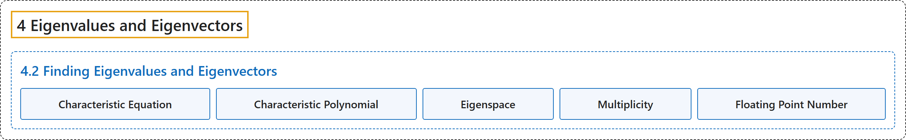

# 4.2 Finding Eigenvalues and Eigenvectors

## Classification

## Glossary

| Term | Definition | 中文翻译 | Source |
|---|---|---|---|
| **4.2 Finding Eigenvalues and Eigenvectors** 求特征值与特征向量 | (No definition) | （无定义） | [Austin, 2023, section 4.2](https://understandinglinearalgebra.org/sec-eigen-find.html) |
| **Characteristic Equation** 特征方程 | "This equation is called the **characteristic equation** of $A$." | 这个方程称为 $A$ 的**特征方程**。 | [Austin, 2023, section 4.2](https://understandinglinearalgebra.org/sec-eigen-find.html#sec-eigen-find-4-4) |
| **Characteristic Polynomial** 特征多项式 | "In general, the expression $\det(A-\lambda I)$ is **a polynomial in $\lambda$**, which is called the **characteristic polynomial** of $A$." | 一般地，表达式 $\det(A-\lambda I)$ 是**关于 $\lambda$ 的多项式**，称为 $A$ 的**特征多项式**。 | [Austin, 2023, section 4.2](https://understandinglinearalgebra.org/sec-eigen-find.html#sec-eigen-find-4-6) |
| **Eigenspace** 特征空间 | "We say that $E_\lambda$ is the **eigenspace** of $A$ **associated to the eigenvalue $\lambda$**." | 我们称 $E_\lambda$ 为 $A$ 的**属于特征值 $\lambda$ 的特征空间**。 | [Austin, 2023, section 4.2](https://understandinglinearalgebra.org/sec-eigen-find.html#sec-eigen-find-5-3) |
| **Multiplicity** 重数 | "**The number of times that $\lambda_j - \lambda$ appears as a factor in the characteristic polynomial**, is called the **multiplicity** of the eigenvalue $\lambda_j$." | **因式 $\lambda_j - \lambda$ 在特征多项式中出现的次数**，称为特征值 $\lambda_j$ 的**重数**。 | [Austin, 2023, section 4.2](https://understandinglinearalgebra.org/sec-eigen-find.html#sec-eigen-find-6-4) |
| **Floating Point Number** 浮点数 | "When working with **decimal entries**, which are called **floating point numbers** in computer science, we must remember that computers perform only approximate arithmetic." | 处理**小数元素**（在计算机科学中称为**浮点数**）时，我们必须记住，计算机只执行近似运算。 | [Austin, 2023, section 4.2](https://understandinglinearalgebra.org/sec-eigen-find.html#sec-eigen-find-7-3-1-1-2-4-1) |

## References

Austin, D. (2023). *Understanding linear algebra* (2023 update). Retrieved October 29, 2026, from <https://understandinglinearalgebra.org/home.html>
