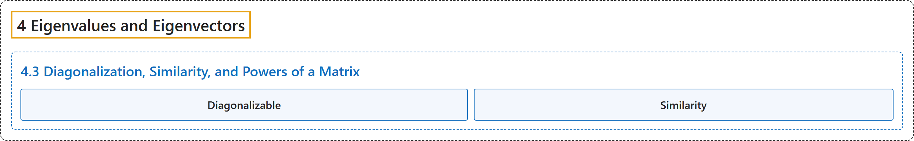

# 4.3 Diagonalization, Similarity, and Powers of a Matrix

## Classification

## Glossary

| Term | Definition | 中文翻译 | Source |
|---|---|---|---|
| **4.3 Diagonalization, Similarity, and Powers of a Matrix** 对角化、相似与矩阵的幂 | (No definition) | （无定义） | [Austin, 2023, section 4.3](https://understandinglinearalgebra.org/sec-eigen-diag.html) |
| **Diagonalizable** 可对角化 | "We say that the matrix $A$ is **diagonalizable** if there is a diagonal matrix $D$ and invertible matrix $P$ such that **$A = PDP^{-1}$**." | 如果存在对角矩阵 $D$ 和可逆矩阵 $P$，使得 **$A = PDP^{-1}$**，则称矩阵 $A$ **可对角化**。 | [Austin, 2023, Definition 4.3.6](https://understandinglinearalgebra.org/sec-eigen-diag.html#sec-eigen-diag-4-8) |
| **Similarity** 相似 | "We say that $A$ is **similar** to $B$ if there is an invertible matrix $P$ such that **$A = PBP^{-1}$**." | 如果存在可逆矩阵 $P$，使得 **$A = PBP^{-1}$**，则称 $A$ **相似于** $B$。 | [Austin, 2023, Definition 4.3.15](https://understandinglinearalgebra.org/sec-eigen-diag.html#sec-eigen-diag-6-4) |

## References

Austin, D. (2023). *Understanding linear algebra* (2023 update). Retrieved October 29, 2026, from <https://understandinglinearalgebra.org/home.html>
