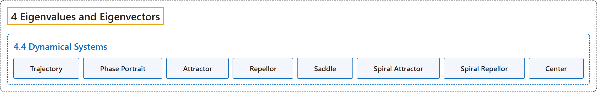

# 4.4 Dynamical Systems

## Classification

## Glossary

| Term | Definition | 中文翻译 | Source |
|---|---|---|---|
| **4.4 Dynamical Systems** 动力系统 | (No definition) | （无定义） | [Austin, 2023, section 4.4](https://understandinglinearalgebra.org/sec-dynamical.html) |
| **Trajectory** 轨线 | "**The sequence of points** $\left\{\mathbf{x}_k\right\}_{{\cal B}}$, called **trajectories**, move along the curves, as shown on the left." | **点列** $\left\{\mathbf{x}_k\right\}_{{\cal B}}$ 称为**轨线**，它们沿着曲线移动，如左图所示。 | [Austin, 2023, section 4.4](https://understandinglinearalgebra.org/sec-dynamical.html#sec-dynamical-4-14) |
| **Phase Portrait** 相图 | "Diagrams like those shown in Figure 4.4.3 are called **phase portraits**." | 像图 4.4.3 中所示的那些图称为**相图**。 | [Austin, 2023, section 4.4](https://understandinglinearalgebra.org/sec-dynamical.html#sec-dynamical-4-17) |
| **Attractor** 吸引子 | "In this case, any nonzero vector $\mathbf{x}_0$ forms a trajectory that **moves into the origin** so we say that the origin is an **attractor**." | 在这种情况下，任何非零向量 $\mathbf{x}_0$ 形成的轨线都**趋向原点**，因此我们称原点是一个**吸引子**。 | [Austin, 2023, section 4.4](https://understandinglinearalgebra.org/sec-dynamical.html#sec-dynamical-5-4-2-3-1) |
| **Repellor** 排斥子 | "In this case, any nonzero vector $\mathbf{x}_0$ forms a trajectory that **moves away from the origin** so we say that the origin is a **repellor**." | 在这种情况下，任何非零向量 $\mathbf{x}_0$ 形成的轨线都**远离原点**，因此我们称原点是一个**排斥子**。 | [Austin, 2023, section 4.4](https://understandinglinearalgebra.org/sec-dynamical.html#sec-dynamical-5-4-2-1-1) |
| **Saddle** 鞍点 | "In this case, we say that the origin is a **saddle** as illustrated in Figure 4.4.6." | 在这种情况下，我们称原点是一个**鞍点**，如图 4.4.6 所示。 | [Austin, 2023, section 4.4](https://understandinglinearalgebra.org/sec-dynamical.html#sec-dynamical-5-4-2-2-1) |
| **Spiral Attractor** 螺旋吸引子 | "We say that the origin is a **spiral attractor**, as illustrated in Figure 4.4.10." | 我们称原点是一个**螺旋吸引子**，如图 4.4.10 所示。 | [Austin, 2023, section 4.4](https://understandinglinearalgebra.org/sec-dynamical.html#sec-dynamical-5-4-2-6-1) |
| **Spiral Repellor** 螺旋排斥子 | "We say that the origin is a **spiral repellor**, as illustrated in Figure 4.4.8." | 我们称原点是一个**螺旋排斥子**，如图 4.4.8 所示。 | [Austin, 2023, section 4.4](https://understandinglinearalgebra.org/sec-dynamical.html#sec-dynamical-5-4-2-4-1) |
| **Center** 中心 | "We say that the origin is a **center**, as illustrated in Figure 4.4.9." | 我们称原点是一个**中心**，如图 4.4.9 所示。 | [Austin, 2023, section 4.4](https://understandinglinearalgebra.org/sec-dynamical.html#sec-dynamical-5-4-2-5-1) |

## References

Austin, D. (2023). *Understanding linear algebra* (2023 update). Retrieved October 29, 2026, from <https://understandinglinearalgebra.org/home.html>
