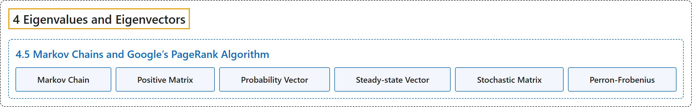

# 4.5 Markov Chains and Google’s PageRank Algorithm

## Classification

## Glossary

| Term | Definition | 中文翻译 | Source |
|---|---|---|---|
| **4.5 Markov Chains and Google’s PageRank Algorithm** 马尔可夫链与 Google 的 PageRank 算法 | (No definition) | （无定义） | [Austin, 2023, section 4.5](https://understandinglinearalgebra.org/sec-stochastic.html) |
| **Markov Chain** 马尔可夫链 | "We call **this sequence of vectors** a **Markov chain**." | 我们称这个**向量序列**为**马尔可夫链**。 | [Austin, 2023, section 4.5](https://understandinglinearalgebra.org/sec-stochastic.html#sec-stochastic-5-2) |
| **Positive Matrix** 正矩阵 | "We say that a matrix $A$ is **positive** if either $A$ or some power $A^k$ **has all positive entries**." | 如果 $A$ 或其某个幂 $A^k$ 的**所有元素都为正**，则称矩阵 $A$ 是**正的**。 | [Austin, 2023, Definition 4.5.7](https://understandinglinearalgebra.org/sec-stochastic.html#sec-stochastic-5-12) |
| **Probability Vector** 概率向量 | "A vector whose **entries are nonnegative and add to 1** is called a **probability vector**." | **元素非负且和为 1** 的向量称为**概率向量**。 | [Austin, 2023, Definition 4.5.2](https://understandinglinearalgebra.org/sec-stochastic.html#sec-stochastic-4-4) |
| **Steady-state Vector** 稳态向量 | "If $A$ is a stochastic matrix, we say that a probability vector $\mathbf{q}$ is a **steady-state** or **stationary vector** if **$A\mathbf{q} = \mathbf{q}$**." | 若 $A$ 是随机矩阵，且概率向量 $\mathbf{q}$ 满足 **$A\mathbf{q} = \mathbf{q}$**，则称 $\mathbf{q}$ 为**稳态向量**或**平稳向量**。 | [Austin, 2023, Definition 4.5.4](https://understandinglinearalgebra.org/sec-stochastic.html#sec-stochastic-5-4) |
| **Stochastic Matrix** 随机矩阵 | "A square matrix whose **columns are probability vectors** is called a **stochastic matrix**." | **各列都是概率向量**的方阵称为**随机矩阵**。 | [Austin, 2023, Definition 4.5.2](https://understandinglinearalgebra.org/sec-stochastic.html#sec-stochastic-4-4) |
| **Perron-Frobenius** 佩龙-弗罗贝尼乌斯定理 | "If $A$ is a positive stochastic matrix, then the eigenvalues satisfy $\lambda_1=1$ and $\vert \lambda_j\vert  \lt 1$ for $j\gt 1$. This means that $A$ has a **unique positive, steady-state vector** $\mathbf{q}$ and that every Markov chain defined by $A$ will **converge to $\mathbf{q}$**." | 若 $A$ 是正随机矩阵，则其特征值满足 $\lambda_1=1$，且当 $j\gt 1$ 时 $\vert \lambda_j\vert  \lt 1$。这意味着 $A$ 有**唯一的正稳态向量** $\mathbf{q}$，并且由 $A$ 定义的每个马尔可夫链都将**收敛于 $\mathbf{q}$**。 | [Austin, 2023, Theorem 4.5.9](https://understandinglinearalgebra.org/sec-stochastic.html#theorem-perron) |

## References

Austin, D. (2023). *Understanding linear algebra* (2023 update). Retrieved October 29, 2026, from <https://understandinglinearalgebra.org/home.html>
