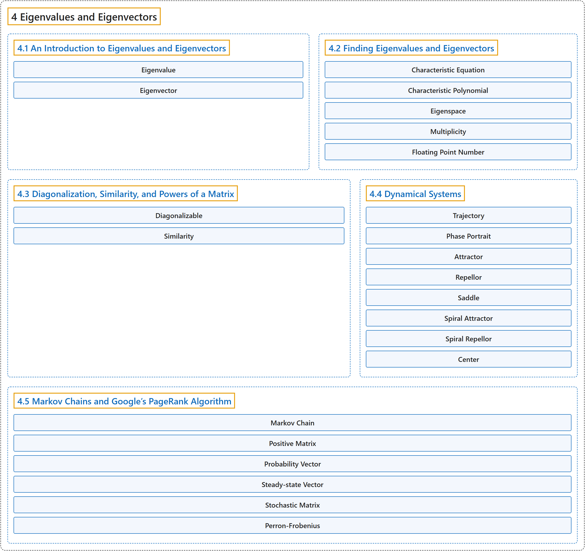

# 4 Eigenvalues and Eigenvectors

## Classification

## Glossary

| Term | Definition | 中文翻译 | Source |
|---|---|---|---|
| **4 Eigenvalues and Eigenvectors** 特征值与特征向量 | (No definition) | （无定义） | [Austin, 2023, chapter 4](https://understandinglinearalgebra.org/chap4.html) |
| **[4.1 An Introduction to Eigenvalues and Eigenvectors](4-1-an-introduction-to-eigenvalues-and-eigenvectors.md)** 特征值与特征向量介绍 | (No definition) | （无定义） | [Austin, 2023, section 4.1](https://understandinglinearalgebra.org/sec-eigen-intro.html) |
| **[4.2 Finding Eigenvalues and Eigenvectors](4-2-finding-eigenvalues-and-eigenvectors.md)** 求特征值与特征向量 | (No definition) | （无定义） | [Austin, 2023, section 4.2](https://understandinglinearalgebra.org/sec-eigen-find.html) |
| **[4.3 Diagonalization, Similarity, and Powers of a Matrix](4-3-diagonalization-similarity-and-powers-of-a-matrix.md)** 对角化、相似与矩阵的幂 | (No definition) | （无定义） | [Austin, 2023, section 4.3](https://understandinglinearalgebra.org/sec-eigen-diag.html) |
| **[4.4 Dynamical Systems](4-4-dynamical-systems.md)** 动力系统 | (No definition) | （无定义） | [Austin, 2023, section 4.4](https://understandinglinearalgebra.org/sec-dynamical.html) |
| **[4.5 Markov Chains and Google’s PageRank Algorithm](4-5-markov-chains-and-google-s-pagerank-algorithm.md)** 马尔可夫链与 Google 的 PageRank 算法 | (No definition) | （无定义） | [Austin, 2023, section 4.5](https://understandinglinearalgebra.org/sec-stochastic.html) |

## References

Austin, D. (2023). *Understanding linear algebra* (2023 update). Retrieved October 29, 2026, from <https://understandinglinearalgebra.org/home.html>
