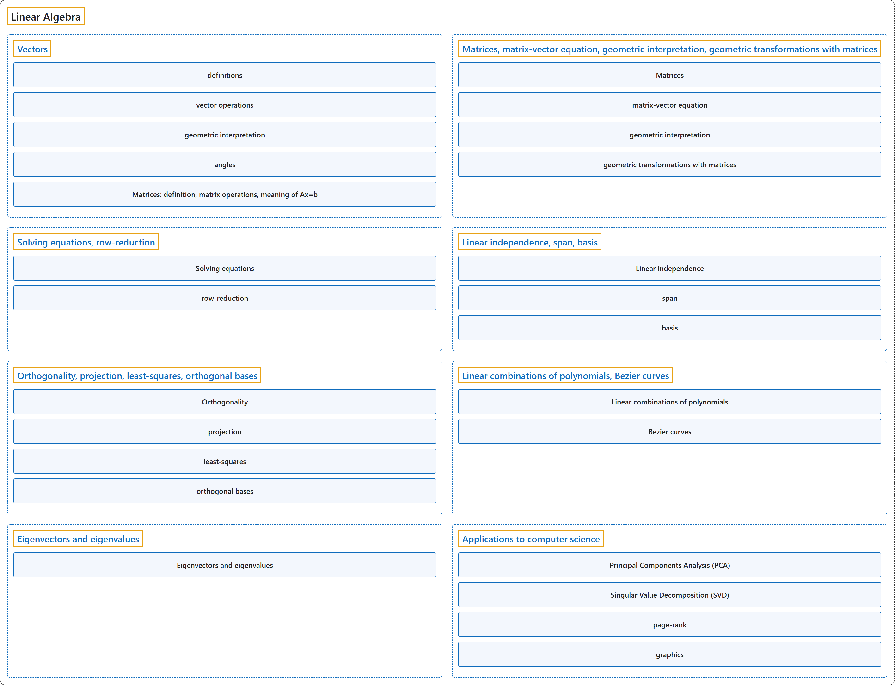

# 4. Linear Algebra

## Classification

## Glossary

| Term | Definition | 中文翻译 | Source |
|---|---|---|---|
| **Linear Algebra** 线性代数 | "Linear algebra is the study of **sets of linear equations** and their **transformation properties**." | 线性代数研究**线性方程组**及其**变换性质**。 | [Weisstein, n.d.-d, "Linear algebra" entry, para. 1](https://mathworld.wolfram.com/LinearAlgebra.html#:~:text=Linear%20algebra%20is%20the%20study%20of%20sets%20of%20linear%20equations) |
| **[Vectors](vectors.md)** 向量 | "A vector is formally defined as **an element of a vector space**." | 向量在形式上定义为**向量空间中的一个元素**。 | [Weisstein, n.d.-h, "Vector" entry, para. 1](https://mathworld.wolfram.com/Vector.html#:~:text=A%20vector%20is%20formally%20defined%20as%20an%20element%20of%20a%20vector%20space) |
| **[Matrices, matrix-vector equation, geometric interpretation, geometric transformations with matrices](matrices-matrix-vector-equation-geometric-interpretation-geometric-transformations-with-matrices.md)** 矩阵、矩阵向量方程、几何解释、用矩阵做几何变换 | "A matrix is a **rectangular array** used to represent and work with **linear transformations**." | 矩阵是一个**矩形数组**，用来表示和处理**线性变换**。 | [Weisstein, n.d.-e, "Matrix" entry, para. 1](https://mathworld.wolfram.com/Matrix.html#:~:text=A%20matrix%20is%20a%20rectangular%20array) |
| **[Solving equations, row-reduction](solving-equations-row-reduction.md)** 解方程、行化简 | (context) "Gaussian elimination is a **method for solving matrix equations** of the form **Ax=b**." | （语境）高斯消元法是一种**求解矩阵方程的方法**，方程形如 **Ax=b**。 | [Weisstein, n.d.-c, "Gaussian elimination" entry, para. 1](https://mathworld.wolfram.com/GaussianElimination.html#:~:text=Gaussian%20elimination%20is%20a%20method%20for%20solving%20matrix%20equations) |
| **[Linear independence, span, basis](linear-independence-span-basis.md)** 线性无关、张成、基 | (context) "A vector basis of a finite-dimensional vector space V is defined as a subset v1,...,vn of vectors in V that are **linearly independent** and **span V**." | （语境）有限维向量空间 V 的向量基定义为 V 中向量的一个子集 v1, ..., vn，这些向量**线性无关**并且**张成 V**。 | [Weisstein, n.d.-i, "Vector basis" entry, para. 1](https://mathworld.wolfram.com/VectorBasis.html#:~:text=A%20vector%20basis%20of%20a%20finite%2Ddimensional%20vector%20space) |
| **[Orthogonality, projection, least-squares, orthogonal bases](orthogonality-projection-least-squares-orthogonal-bases.md)** 正交性、投影、最小二乘、正交基 | "Orthogonal means **perpendicular** in **elementary geometry**." | 正交的意思是**垂直**，这是在**初等几何**中的含义。 | [Weisstein, n.d.-f, "Orthogonal" entry, para. 1](https://mathworld.wolfram.com/Orthogonal.html#:~:text=Orthogonal%20means%20perpendicular%20in%20elementary%20geometry) |
| **[Linear combinations of polynomials, Bezier curves](linear-combinations-of-polynomials-bezier-curves.md)** 多项式的线性组合、贝塞尔曲线 | (context) "The Bernstein polynomials of degree n **form a basis** for the **power polynomials of degree n**." | （语境）n 次伯恩斯坦多项式**构成一组基**，用于表示 **n 次幂多项式**。 | [Weisstein, n.d.-a, "Bernstein polynomial" entry, para. 2](https://mathworld.wolfram.com/BernsteinPolynomial.html#:~:text=form%20a%20basis%20for%20the%20power%20polynomials) |
| **[Eigenvectors and eigenvalues](eigenvectors-and-eigenvalues.md)** 特征向量和特征值 | "Eigenvectors are a **special set of vectors** associated with a **linear system of equations** (i.e., a matrix equation) that are sometimes also known as characteristic vectors, proper vectors, or latent vectors ..." | 特征向量是一组**特殊的向量**，与**线性方程组**（即矩阵方程）相关联，有时也称为特性向量、固有向量或潜在向量…… | [Weisstein, n.d.-b, "Eigenvector" entry, para. 1](https://mathworld.wolfram.com/Eigenvector.html#:~:text=Eigenvectors%20are%20a%20special%20set%20of%20vectors) |
| **[Applications to computer science](applications-to-computer-science.md)** 在计算机科学中的应用 | (context) "Principal component analysis (PCA) is a method for replacing a collection of **possibly correlated variables** by **uncorrelated linear combinations** called principal components." | （语境）主成分分析（PCA）是一种方法，它把一组**可能相关的变量**替换为**不相关的线性组合**，这些组合称为主成分。 | [Weisstein, n.d.-g, "Principal component analysis" entry, para. 1](https://mathworld.wolfram.com/PrincipalComponentAnalysis.html#:~:text=is%20a%20method%20for%20replacing%20a%20collection%20of%20possibly%20correlated%20variables) |

## References

- Joint Task Force on Computing Curricula. (2024). *Computer science curricula 2023*. Association for Computing Machinery. <https://doi.org/10.1145/3664191>
- Weisstein, E. W. (n.d.-a). *Bernstein polynomial*. MathWorld: A Wolfram Resource. Retrieved October 27, 2026, from <https://mathworld.wolfram.com/BernsteinPolynomial.html>
- Weisstein, E. W. (n.d.-b). *Eigenvector*. MathWorld: A Wolfram Resource. Retrieved October 27, 2026, from <https://mathworld.wolfram.com/Eigenvector.html>
- Weisstein, E. W. (n.d.-c). *Gaussian elimination*. MathWorld: A Wolfram Resource. Retrieved October 27, 2026, from <https://mathworld.wolfram.com/GaussianElimination.html>
- Weisstein, E. W. (n.d.-d). *Linear algebra*. MathWorld: A Wolfram Resource. Retrieved October 27, 2026, from <https://mathworld.wolfram.com/LinearAlgebra.html>
- Weisstein, E. W. (n.d.-e). *Matrix*. MathWorld: A Wolfram Resource. Retrieved October 27, 2026, from <https://mathworld.wolfram.com/Matrix.html>
- Weisstein, E. W. (n.d.-f). *Orthogonal*. MathWorld: A Wolfram Resource. Retrieved October 27, 2026, from <https://mathworld.wolfram.com/Orthogonal.html>
- Weisstein, E. W. (n.d.-g). *Principal component analysis*. MathWorld: A Wolfram Resource. Retrieved October 27, 2026, from <https://mathworld.wolfram.com/PrincipalComponentAnalysis.html>
- Weisstein, E. W. (n.d.-h). *Vector*. MathWorld: A Wolfram Resource. Retrieved October 27, 2026, from <https://mathworld.wolfram.com/Vector.html>
- Weisstein, E. W. (n.d.-i). *Vector basis*. MathWorld: A Wolfram Resource. Retrieved October 27, 2026, from <https://mathworld.wolfram.com/VectorBasis.html>
