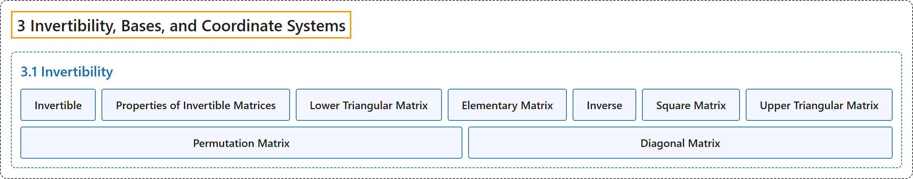

# 3.1 Invertibility

## Classification

## Glossary

| Term | Definition | 中文翻译 | Source |
|---|---|---|---|
| **3.1 Invertibility** 可逆性 | (No definition) | （无定义） | [Austin, 2023, section 3.1](https://understandinglinearalgebra.org/sec-matrix-inverse.html) |
| **Invertible** 可逆 | "An $n\times n$ matrix $A$ is called **invertible** if **there is a matrix $B$ such that $AB = I_n$**, where $I_n$ is the $n\times n$ identity matrix." | 对于 $n\times n$ 矩阵 $A$，如果**存在矩阵 $B$ 使得 $AB = I_n$**，其中 $I_n$ 是 $n\times n$ 单位矩阵，就称 $A$ **可逆**。 | [Austin, 2023, Definition 3.1.2](https://understandinglinearalgebra.org/sec-matrix-inverse.html#subsec-invertible-matrices-4) |
| **Properties of Invertible Matrices** 可逆矩阵的性质 | "An $n\times n$ matrix $A$ is **invertible** if and only if $A\sim I$. If $A$ is invertible, then the solution to the equation $A\mathbf{x} = \mathbf{b}$ is given by $\mathbf{x} = A^{-1}\mathbf{b}$. We can find $A^{-1}$ by finding the reduced row echelon form of $\left[\begin{array}{r\|r} A & I \end{array}\right]$; namely, $\left[\begin{array}{r\|r} A & I \end{array}\right] \sim \left[\begin{array}{r\|r} I & A^{-1} \end{array}\right]$. If $A$ and $B$ are two invertible $n\times n$ matrices, then their product $AB$ is **also invertible** and $(AB)^{-1} = B^{-1}A^{-1}$." | $n\times n$ 矩阵 $A$ **可逆**，当且仅当 $A\sim I$。若 $A$ 可逆，则方程 $A\mathbf{x} = \mathbf{b}$ 的解为 $\mathbf{x} = A^{-1}\mathbf{b}$。求 $\left[\begin{array}{r\|r} A & I \end{array}\right]$ 的行最简形就能得到 $A^{-1}$，即 $\left[\begin{array}{r\|r} A & I \end{array}\right] \sim \left[\begin{array}{r\|r} I & A^{-1} \end{array}\right]$。若 $A$ 与 $B$ 是两个可逆的 $n\times n$ 矩阵，则它们的乘积 $AB$ **也可逆**，且 $(AB)^{-1} = B^{-1}A^{-1}$。 | [Austin, 2023, Proposition 3.1.10](https://understandinglinearalgebra.org/sec-matrix-inverse.html#proposition-invertible-properties) |
| **Lower Triangular Matrix** 下三角矩阵 | "We say that a matrix $A$ is **lower triangular** if **all its entries above the diagonal are zero**." | 如果矩阵 $A$ 的**对角线上方的元素全为零**，就称 $A$ 是**下三角**矩阵。 | [Austin, 2023, Definition 3.1.11](https://understandinglinearalgebra.org/sec-matrix-inverse.html#subsec-triangular-invertible-3) |
| **Elementary Matrix** 初等矩阵 | "The following are examples of matrices, known as **elementary matrices**, that **perform the row operations on a matrix** having three rows." | 下面是一些称为**初等矩阵**的矩阵的例子，它们对有三行的矩阵**施行行变换**。 | [Austin, 2023, section 3.1](https://understandinglinearalgebra.org/sec-matrix-inverse.html#subsec-triangular-invertible-9) |
| **Inverse** 逆矩阵 | "The matrix $B$ is called the **inverse** of $A$ and denoted $A^{-1}$." | 矩阵 $B$ 称为 $A$ 的**逆矩阵**，记作 $A^{-1}$。 | [Austin, 2023, Definition 3.1.2](https://understandinglinearalgebra.org/sec-matrix-inverse.html#subsec-invertible-matrices-4) |
| **Square Matrix** 方阵 | "Notice that we only define invertibility for matrices that **have the same number of rows and columns** in which case we say that the matrix is **square**." | 注意，我们只对**行数与列数相同**的矩阵定义可逆性，此时称该矩阵为**方阵**。 | [Austin, 2023, section 3.1](https://understandinglinearalgebra.org/sec-matrix-inverse.html#subsec-invertible-matrices-5) |
| **Upper Triangular Matrix** 上三角矩阵 | "Similarly, $A$ is **upper triangular** if **all the entries below the diagonal are zero**." | 类似地，如果 $A$ 的**对角线下方的元素全为零**，就称 $A$ 是**上三角**矩阵。 | [Austin, 2023, Definition 3.1.11](https://understandinglinearalgebra.org/sec-matrix-inverse.html#subsec-triangular-invertible-3) |
| **Permutation Matrix** 置换矩阵 | "Find a matrix $P$, usually called a **permutation matrix** that **performs this operation**." | 求一个**完成这一运算**的矩阵 $P$，它通常称为**置换矩阵**。 | [Austin, 2023, section 3.1](https://understandinglinearalgebra.org/sec-matrix-inverse.html#subsec-triangular-invertible-8-2-2-6-5-1) |
| **Diagonal Matrix** 对角矩阵 | "The matrix $D=\begin{bmatrix} 2 & 0 & 0 \\ 0 & -1 & 0 \\ 0 & 0 & -4 \\ \end{bmatrix}$ is called **diagonal** since **the only nonzero entries are on the diagonal of the matrix**." | 矩阵 $D=\begin{bmatrix} 2 & 0 & 0 \\ 0 & -1 & 0 \\ 0 & 0 & -4 \\ \end{bmatrix}$ 称为**对角**矩阵，因为它**仅有的非零元素都在矩阵的对角线上**。 | [Austin, 2023, section 3.1](https://understandinglinearalgebra.org/sec-matrix-inverse.html#sec-matrix-inverse-8-3-1-1-1-1-1) |

## References

Austin, D. (2023). *Understanding linear algebra* (2023 update). Retrieved October 29, 2026, from <https://understandinglinearalgebra.org/home.html>
