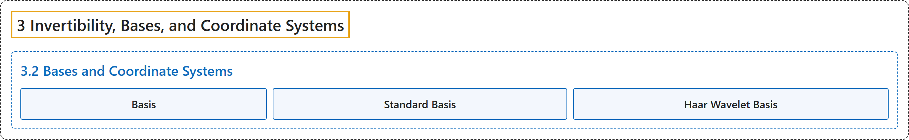

# 3.2 Bases and Coordinate Systems

## Classification

## Glossary

| Term | Definition | 中文翻译 | Source |
|---|---|---|---|
| **3.2 Bases and Coordinate Systems** 基与坐标系 | (No definition) | （无定义） | [Austin, 2023, section 3.2](https://understandinglinearalgebra.org/sec-bases.html) |
| **Basis** 基 | "A set of vectors $\mathbf{v}_1,\mathbf{v}_2,\ldots,\mathbf{v}_n$ in $\mathbb{R}^m$ is called a **basis** for $\mathbb{R}^m$ if the set of vectors **spans $\mathbb{R}^m$ and is linearly independent**." | 如果 $\mathbb{R}^m$ 中的向量组 $\mathbf{v}_1,\mathbf{v}_2,\ldots,\mathbf{v}_n$ **张成 $\mathbb{R}^m$ 且线性无关**，就称它是 $\mathbb{R}^m$ 的一个**基**。 | [Austin, 2023, Definition 3.2.4](https://understandinglinearalgebra.org/sec-bases.html#sec-bases-4-3) |
| **Standard Basis** 标准基 | "More generally, the set of vectors $\mathbf{e}_1,\mathbf{e}_2,\ldots,\mathbf{e}_m$ forms a basis for $\mathbb{R}^m$, which we call the **standard basis** for $\mathbb{R}^m$." | 更一般地，向量组 $\mathbf{e}_1,\mathbf{e}_2,\ldots,\mathbf{e}_m$ 构成 $\mathbb{R}^m$ 的一个基，我们称之为 $\mathbb{R}^m$ 的**标准基**。 | [Austin, 2023, Example 3.2.7](https://understandinglinearalgebra.org/sec-bases.html#sec-bases-4-9) |
| **Haar Wavelet Basis** Haar 小波基 | "This basis is sometimes called a **Haar wavelet basis**, and the change of basis is known as a Haar wavelet transform." | 这个基有时称为 **Haar 小波基**，而相应的基变换称为 Haar 小波变换。 | [Austin, 2023, section 3.2](https://understandinglinearalgebra.org/sec-bases.html#example-wavelet-basis-1-10) |

## References

Austin, D. (2023). *Understanding linear algebra* (2023 update). Retrieved October 29, 2026, from <https://understandinglinearalgebra.org/home.html>
