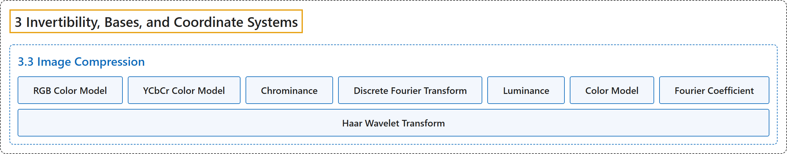

# 3.3 Image Compression

## Classification

## Glossary

| Term | Definition | 中文翻译 | Source |
|---|---|---|---|
| **3.3 Image Compression** 图像压缩 | (No definition) | （无定义） | [Austin, 2023, section 3.3](https://understandinglinearalgebra.org/sec-jpeg.html) |
| **RGB Color Model** RGB 颜色模型 | "This is called the **$RGB$ color model**." | 这称为 **$RGB$ 颜色模型**。 | [Austin, 2023, section 3.3](https://understandinglinearalgebra.org/sec-jpeg.html#sec-jpeg-4-3) |
| **YCbCr Color Model** YCbCr 颜色模型 | "This is known as the **$YC_bC_r$ color model**." | 这称为 **$YC_bC_r$ 颜色模型**。 | [Austin, 2023, section 3.3](https://understandinglinearalgebra.org/sec-jpeg.html#sec-jpeg-4-4) |
| **Chrominance** 色度 | "The coordinate $Y$ is called luminance while $C_b$ and $C_r$ are called **blue and red chrominance**, respectively." | 坐标 $Y$ 称为亮度，而 $C_b$ 和 $C_r$ 分别称为**蓝色色度和红色色度**。 | [Austin, 2023, section 3.3](https://understandinglinearalgebra.org/sec-jpeg.html#sec-jpeg-4-4) |
| **Discrete Fourier Transform** 离散傅里叶变换 | "The JPEG compression algorithm uses the **Discrete Fourier Transform**, which is **defined using the basis ${\cal B}$** whose basis vectors are …" | JPEG 压缩算法使用**离散傅里叶变换**，它是**用基 ${\cal B}$ 定义的**，其基向量为 … | [Austin, 2023, section 3.3](https://understandinglinearalgebra.org/sec-jpeg.html#sec-jpeg-5-10) |
| **Luminance** 亮度 | "The coordinate $Y$ is called **luminance** while $C_b$ and $C_r$ are called blue and red chrominance, respectively." | 坐标 $Y$ 称为**亮度**，而 $C_b$ 和 $C_r$ 分别称为蓝色色度和红色色度。 | [Austin, 2023, section 3.3](https://understandinglinearalgebra.org/sec-jpeg.html#sec-jpeg-4-4) |
| **Color Model** 颜色模型 | "We will describe two of these representations, called **color models**, and demonstrate how they are used in the JPEG compression algorithm." | 我们将介绍其中两种称为**颜色模型**的表示方式，并说明它们在 JPEG 压缩算法中的用法。 | [Austin, 2023, section 3.3](https://understandinglinearalgebra.org/sec-jpeg.html#sec-jpeg-4-2) |
| **Fourier Coefficient** 傅里叶系数 | "The coordinates $F_j$ are called the **Fourier coefficients** of the vector $\mathbf{x}$." | 坐标 $F_j$ 称为向量 $\mathbf{x}$ 的**傅里叶系数**。 | [Austin, 2023, section 3.3](https://understandinglinearalgebra.org/sec-jpeg.html#sec-jpeg-5-13-1) |
| **Haar Wavelet Transform** Haar 小波变换 | "The **change of coordinates from a vector $\mathbf{x}$ in $\mathbb{R}^4$ to $\left\{\mathbf{x}\right\}_{{\cal W}}$** is called the **Haar wavelet transform** and we write $\left\{\mathbf{x}\right\}_{{\cal W}} = \left[\begin{array}{r}H_1 \\ H_2 \\ H_3 \\ H_4 \end{array}\right]$." | **从 $\mathbb{R}^4$ 中的向量 $\mathbf{x}$ 到 $\left\{\mathbf{x}\right\}_{{\cal W}}$ 的坐标变换**称为 **Haar 小波变换**，并记作 $\left\{\mathbf{x}\right\}_{{\cal W}} = \left[\begin{array}{r}H_1 \\ H_2 \\ H_3 \\ H_4 \end{array}\right]$。 | [Austin, 2023, section 3.3](https://understandinglinearalgebra.org/sec-jpeg.html#sec-jpeg-7-4-1-3) |

## References

Austin, D. (2023). *Understanding linear algebra* (2023 update). Retrieved October 29, 2026, from <https://understandinglinearalgebra.org/home.html>
