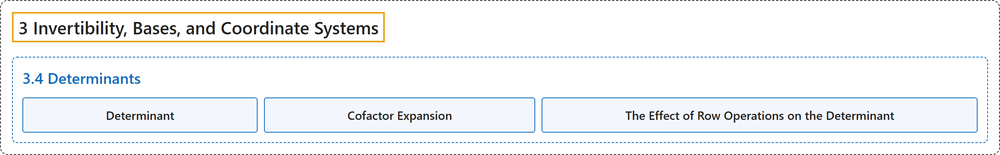

# 3.4 Determinants

## Classification

## Glossary

| Term | Definition | 中文翻译 | Source |
|---|---|---|---|
| **3.4 Determinants** 行列式 | (No definition) | （无定义） | [Austin, 2023, section 3.4](https://understandinglinearalgebra.org/sec-determinants.html) |
| **Determinant** 行列式 | "If the pair of vectors is positively oriented, then the **determinant** of $A$, denoted $\det(A)$, is **the area of the parallelogram formed by $\mathbf{v}_1$ and $\mathbf{v}_2$**." | 如果这对向量是正定向的，那么 $A$ 的**行列式**（记作 $\det(A)$）就是**由 $\mathbf{v}_1$ 和 $\mathbf{v}_2$ 构成的平行四边形的面积**。 | [Austin, 2023, Definition 3.4.4](https://understandinglinearalgebra.org/sec-determinants.html#sec-determinants-4-4) |
| **Cofactor Expansion** 余因子展开 | "There is **another way to compute determinants**, using what are called **cofactor expansions**, that will be important for us in the next chapter." | 还有**另一种计算行列式的方法**，即使用所谓的**余因子展开**，它在下一章中对我们很重要。 | [Austin, 2023, section 3.4](https://understandinglinearalgebra.org/sec-determinants.html#sec-determinants-6-2) |
| **The Effect of Row Operations on the Determinant** 行变换对行列式的影响 | "If $A'$ is obtained from $A$ by **scaling a row** by $k$, then $\det(A') = k\det(A)$. If $A'$ is obtained from $A$ by **interchanging two rows**, then $\det(A') = -\det(A)$. If $A'$ is obtained from $A$ by performing a **row replacement operation**, then $\det(A') = \det(A)$." | 若 $A'$ 由 $A$ 把某一行**乘以** $k$ 得到，则 $\det(A') = k\det(A)$。若 $A'$ 由 $A$ **交换两行**得到，则 $\det(A') = -\det(A)$。若 $A'$ 由 $A$ 经过一次**倍加变换**得到，则 $\det(A') = \det(A)$。 | [Austin, 2023, Proposition 3.4.13](https://understandinglinearalgebra.org/sec-determinants.html#proposition-det-row-operations) |

## References

Austin, D. (2023). *Understanding linear algebra* (2023 update). Retrieved October 29, 2026, from <https://understandinglinearalgebra.org/home.html>
