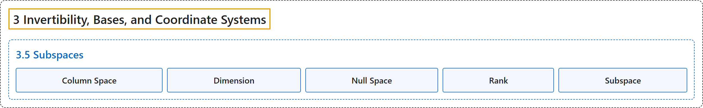

# 3.5 Subspaces

## Classification

## Glossary

| Term | Definition | 中文翻译 | Source |
|---|---|---|---|
| **3.5 Subspaces** 子空间 | (No definition) | （无定义） | [Austin, 2023, section 3.5](https://understandinglinearalgebra.org/sec-subspaces.html) |
| **Column Space** 列空间 | "If $A$ is an $m\times n$ matrix, we call **the span of its columns** the **column space** of $A$ and denote it as $\text{Col}(A)$." | 如果 $A$ 是 $m\times n$ 矩阵，我们把**它的各列的张成**称为 $A$ 的**列空间**，记作 $\text{Col}(A)$。 | [Austin, 2023, Definition 3.5.8](https://understandinglinearalgebra.org/sec-subspaces.html#sec-subspaces-5-3) |
| **Dimension** 维数 | "We say that the **dimension** of the subspace $S$, denoted $\dim S$, is **the number of vectors in any basis**." | 我们说子空间 $S$ 的**维数**（记作 $\dim S$）是**它的任意一个基中向量的个数**。 | [Austin, 2023, Definition 3.5.6](https://understandinglinearalgebra.org/sec-subspaces.html#sec-subspaces-4-8) |
| **Null Space** 零空间 | "If $A$ is an $m\times n$ matrix, we call **the subset of vectors $\mathbf{x}$ in $\mathbb{R}^n$ satisfying $A\mathbf{x} = \mathbf{0}$** the **null space** of $A$ and denote it by $\text{Nul}(A)$." | 如果 $A$ 是 $m\times n$ 矩阵，我们把 **$\mathbb{R}^n$ 中满足 $A\mathbf{x} = \mathbf{0}$ 的向量 $\mathbf{x}$ 构成的子集**称为 $A$ 的**零空间**，记作 $\text{Nul}(A)$。 | [Austin, 2023, Definition 3.5.13](https://understandinglinearalgebra.org/sec-subspaces.html#sec-subspaces-6-3) |
| **Rank** 秩 | "The **rank** of a matrix $A$ is **the number of pivot positions in $A$** and is denoted by $\operatorname{rank}(A)$." | 矩阵 $A$ 的**秩**是 **$A$ 中主元位置的个数**，记作 $\operatorname{rank}(A)$。 | [Austin, 2023, Definition 3.5.11](https://understandinglinearalgebra.org/sec-subspaces.html#sec-subspaces-5-8) |
| **Subspace** 子空间 | "A **subspace** of $\mathbb{R}^p$ is **a subset of $\mathbb{R}^p$ that is the span of a set of vectors**." | $\mathbb{R}^p$ 的**子空间**是指 **$\mathbb{R}^p$ 的一个子集，它是某组向量的张成**。 | [Austin, 2023, Definition 3.5.2](https://understandinglinearalgebra.org/sec-subspaces.html#sec-subspaces-4-3) |

## References

Austin, D. (2023). *Understanding linear algebra* (2023 update). Retrieved October 29, 2026, from <https://understandinglinearalgebra.org/home.html>
