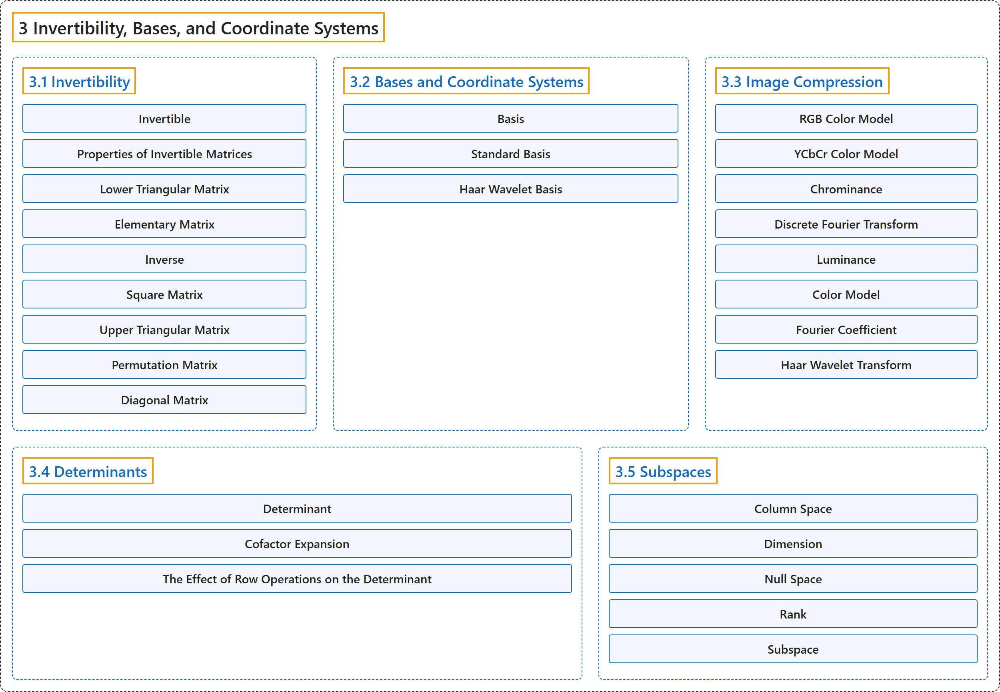

# 3 Invertibility, Bases, and Coordinate Systems

## Classification

## Glossary

| Term | Definition | 中文翻译 | Source |
|---|---|---|---|
| **3 Invertibility, Bases, and Coordinate Systems** 可逆性、基与坐标系 | (No definition) | （无定义） | [Austin, 2023, chapter 3](https://understandinglinearalgebra.org/chap3.html) |
| **[3.1 Invertibility](3-1-invertibility.md)** 可逆性 | (No definition) | （无定义） | [Austin, 2023, section 3.1](https://understandinglinearalgebra.org/sec-matrix-inverse.html) |
| **[3.2 Bases and Coordinate Systems](3-2-bases-and-coordinate-systems.md)** 基与坐标系 | (No definition) | （无定义） | [Austin, 2023, section 3.2](https://understandinglinearalgebra.org/sec-bases.html) |
| **[3.3 Image Compression](3-3-image-compression.md)** 图像压缩 | (No definition) | （无定义） | [Austin, 2023, section 3.3](https://understandinglinearalgebra.org/sec-jpeg.html) |
| **[3.4 Determinants](3-4-determinants.md)** 行列式 | (No definition) | （无定义） | [Austin, 2023, section 3.4](https://understandinglinearalgebra.org/sec-determinants.html) |
| **[3.5 Subspaces](3-5-subspaces.md)** 子空间 | (No definition) | （无定义） | [Austin, 2023, section 3.5](https://understandinglinearalgebra.org/sec-subspaces.html) |

## References

Austin, D. (2023). *Understanding linear algebra* (2023 update). Retrieved October 29, 2026, from <https://understandinglinearalgebra.org/home.html>
