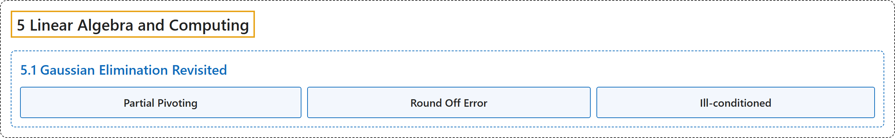

# 5.1 Gaussian Elimination Revisited

## Classification

## Glossary

| Term | Definition | 中文翻译 | Source |
|---|---|---|---|
| **5.1 Gaussian Elimination Revisited** 再论高斯消元法 | (No definition) | （无定义） | [Austin, 2023, section 5.1](https://understandinglinearalgebra.org/sec-gaussian-revisited.html) |
| **Partial Pivoting** 部分主元法 | "This technique is called **partial pivoting**, and it means that, in practice, we will perform **many more row interchange operations** than we typically do when computing exactly by hand." | 这种技术称为**部分主元法**，这意味着在实践中，我们将执行比手工精确计算时**多得多的行交换运算**。 | [Austin, 2023, section 5.1](https://understandinglinearalgebra.org/sec-gaussian-revisited.html#subsec-partial-pivot-16) |
| **Round Off Error** 舍入误差 | "Generally speaking, we will see this problem, which is called **round off error**, whenever we **add numbers of signficantly different magnitudes**." | 一般来说，每当我们**把数量级相差很大的数相加**时，都会遇到这个问题，它称为**舍入误差**。 | [Austin, 2023, section 5.1](https://understandinglinearalgebra.org/sec-gaussian-revisited.html#subsec-partial-pivot-4) |
| **Ill-conditioned** 病态 | "In this case, we say that the matrix $A$ is **ill-conditioned** because the solutions are **extremely sensitive to small changes** in the right hand side of the equation." | 在这种情况下，我们称矩阵 $A$ 是**病态的**，因为方程的解对方程右端的**微小变化极其敏感**。 | [Austin, 2023, section 5.1](https://understandinglinearalgebra.org/sec-gaussian-revisited.html#sec-gaussian-revisited-7-1-1-2) |

## References

Austin, D. (2023). *Understanding linear algebra* (2023 update). Retrieved October 29, 2026, from <https://understandinglinearalgebra.org/home.html>
