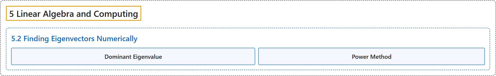

# 5.2 Finding Eigenvectors Numerically

## Classification

## Glossary

| Term | Definition | 中文翻译 | Source |
|---|---|---|---|
| **5.2 Finding Eigenvectors Numerically** 数值求特征向量 | (No definition) | （无定义） | [Austin, 2023, section 5.2](https://understandinglinearalgebra.org/sec-power-method.html) |
| **Dominant Eigenvalue** 主特征值 | "We begin by searching for the eigenvalue having the **largest absolute value**, which is called the **dominant eigenvalue**." | 我们首先寻找**绝对值最大**的特征值，它称为**主特征值**。 | [Austin, 2023, section 5.2](https://understandinglinearalgebra.org/sec-power-method.html#sec-power-method-4-2) |
| **Power Method** 幂法 | "This is the **power method** for **finding an eigenvector associated to the dominant eigenvalue** of a matrix." | 这就是**幂法**，用于**求矩阵的主特征值所对应的特征向量**。 | [Austin, 2023, Example 5.2.3](https://understandinglinearalgebra.org/sec-power-method.html#sec-power-method-4-4) |

## References

Austin, D. (2023). *Understanding linear algebra* (2023 update). Retrieved October 29, 2026, from <https://understandinglinearalgebra.org/home.html>
