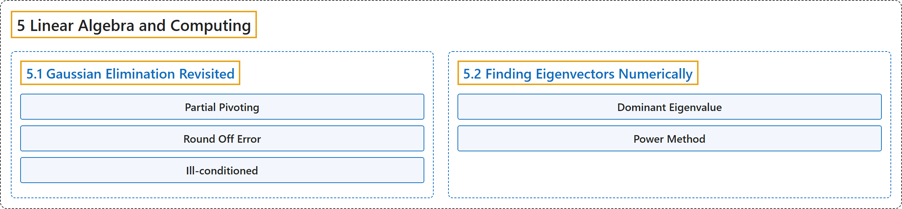

# 5 Linear Algebra and Computing

## Classification

## Glossary

| Term | Definition | 中文翻译 | Source |
|---|---|---|---|
| **5 Linear Algebra and Computing** 线性代数与计算 | (No definition) | （无定义） | [Austin, 2023, chapter 5](https://understandinglinearalgebra.org/chap5.html) |
| **[5.1 Gaussian Elimination Revisited](5-1-gaussian-elimination-revisited.md)** 再论高斯消元法 | (No definition) | （无定义） | [Austin, 2023, section 5.1](https://understandinglinearalgebra.org/sec-gaussian-revisited.html) |
| **[5.2 Finding Eigenvectors Numerically](5-2-finding-eigenvectors-numerically.md)** 数值求特征向量 | (No definition) | （无定义） | [Austin, 2023, section 5.2](https://understandinglinearalgebra.org/sec-power-method.html) |

## References

Austin, D. (2023). *Understanding linear algebra* (2023 update). Retrieved October 29, 2026, from <https://understandinglinearalgebra.org/home.html>
