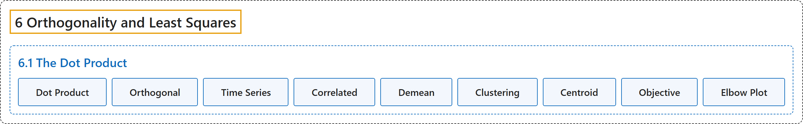

# 6.1 The Dot Product

## Classification

## Glossary

| Term | Definition | 中文翻译 | Source |
|---|---|---|---|
| **6.1 The Dot Product** 点积 | (No definition) | （无定义） | [Austin, 2023, section 6.1](https://understandinglinearalgebra.org/sec-dot-product.html) |
| **Dot Product** 点积 | "The **dot product** is defined, more generally, for any two $m$-dimensional vectors: $\mathbf{v}\cdot\mathbf{w} = \left[ \begin{array}{c} v_1 \\ v_2 \\ \vdots \\ v_m \\ \end{array} \right] \cdot \left[ \begin{array}{c} w_1 \\ w_2 \\ \vdots \\ w_m \\ \end{array} \right] = v_1w_1 + v_2w_2 + \ldots + v_mw_m$. The important thing to remember is that the dot product will **produce a scalar**." | 更一般地，**点积**对任意两个 $m$ 维向量都有定义：$\mathbf{v}\cdot\mathbf{w} = \left[ \begin{array}{c} v_1 \\ v_2 \\ \vdots \\ v_m \\ \end{array} \right] \cdot \left[ \begin{array}{c} w_1 \\ w_2 \\ \vdots \\ w_m \\ \end{array} \right] = v_1w_1 + v_2w_2 + \ldots + v_mw_m$。需要记住的重要一点是，点积**产生一个标量**。 | [Austin, 2023, section 6.1](https://understandinglinearalgebra.org/sec-dot-product.html#sec-dot-product-4-2) |
| **Orthogonal** 正交 | "We say that vectors $\mathbf{v}$ and $\mathbf{w}$ are **orthogonal** if **$\mathbf{v}\cdot\mathbf{w}=0$**." | 如果 **$\mathbf{v}\cdot\mathbf{w}=0$**，则称向量 $\mathbf{v}$ 与 $\mathbf{w}$ **正交**。 | [Austin, 2023, Definition 6.1.9](https://understandinglinearalgebra.org/sec-dot-product.html#sec-dot-product-4-16) |
| **Time Series** 时间序列 | "When interpreted in this way, we call the vector a **time series**." | 按这种方式解释时，我们称该向量为**时间序列**。 | [Austin, 2023, section 6.1](https://understandinglinearalgebra.org/sec-dot-product.html#sec-dot-product-4-20-1-1-1-2-1) |
| **Correlated** 相关 | "We often say that they are **correlated**, and we would like to measure the degree to which they are correlated." | 我们常说它们是**相关的**，并且我们希望度量它们相关的程度。 | [Austin, 2023, section 6.1](https://understandinglinearalgebra.org/sec-dot-product.html#sec-dot-product-4-20-1-1-1-2-3) |
| **Demean** 去均值 | "In order to compare the ways in which they rise and fall, we will first **demean** the time series; that is, for each time series, we will **subtract its average value** to obtain a new time series." | 为了比较它们升降的方式，我们首先对时间序列**去均值**；也就是说，对每个时间序列，**减去其平均值**，得到一个新的时间序列。 | [Austin, 2023, section 6.1](https://understandinglinearalgebra.org/sec-dot-product.html#sec-dot-product-4-20-1-1-1-2-3-2-1-1) |
| **Clustering** 聚类 | "We call the result a **clustering**." | 我们称这个结果为一个**聚类**。 | [Austin, 2023, section 6.1](https://understandinglinearalgebra.org/sec-dot-product.html#sec-dot-product-5-5) |
| **Centroid** 质心 | "To begin, we identify the **centroid**, or the **average**, of a set of vectors $\mathbf{v}_1, \mathbf{v}_2, \ldots,\mathbf{v}_n$ as $\frac1n\left(\mathbf{v}_1+\mathbf{v}_2+\ldots+\mathbf{v}_n\right)$." | 首先，我们将一组向量 $\mathbf{v}_1, \mathbf{v}_2, \ldots,\mathbf{v}_n$ 的**质心**（即**平均值**）定义为 $\frac1n\left(\mathbf{v}_1+\mathbf{v}_2+\ldots+\mathbf{v}_n\right)$。 | [Austin, 2023, section 6.1](https://understandinglinearalgebra.org/sec-dot-product.html#sec-dot-product-5-7-1-1) |
| **Objective** 目标函数 | "If we have a clustering, we therefore define a function, called the **objective**, which measures the **average of the square of the distance from each point to the centroid of the cluster to which that point belongs**." | 因此，如果有一个聚类，我们就定义一个称为**目标函数**的函数，它度量**每个点到其所属簇的质心的距离平方的平均值**。 | [Austin, 2023, section 6.1](https://understandinglinearalgebra.org/sec-dot-product.html#sec-dot-product-5-11) |
| **Elbow Plot** 肘部图 | "This plot is called an **elbow plot** due to its shape." | 这种图因其形状而称为**肘部图**。 | [Austin, 2023, section 6.1](https://understandinglinearalgebra.org/sec-dot-product.html#sec-dot-product-5-13-1-1-2-5-5) |

## References

Austin, D. (2023). *Understanding linear algebra* (2023 update). Retrieved October 29, 2026, from <https://understandinglinearalgebra.org/home.html>
