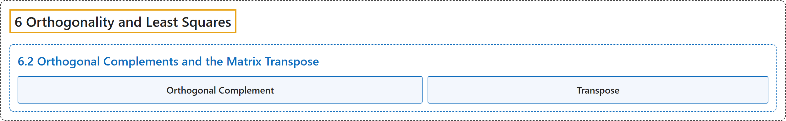

# 6.2 Orthogonal Complements and the Matrix Transpose

## Classification

## Glossary

| Term | Definition | 中文翻译 | Source |
|---|---|---|---|
| **6.2 Orthogonal Complements and the Matrix Transpose** 正交补与矩阵的转置 | (No definition) | （无定义） | [Austin, 2023, section 6.2](https://understandinglinearalgebra.org/sec-transpose.html) |
| **Orthogonal Complement** 正交补 | "Given a subspace $W$ of $\mathbb{R}^m$, the **orthogonal complement** of $W$ is the set of vectors in $\mathbb{R}^m$ each of which is **orthogonal to every vector in $W$**. We denote the orthogonal complement by $W^\perp$." | 给定 $\mathbb{R}^m$ 的子空间 $W$，$W$ 的**正交补**是 $\mathbb{R}^m$ 中**与 $W$ 中每个向量都正交**的向量所组成的集合。我们用 $W^\perp$ 表示正交补。 | [Austin, 2023, Definition 6.2.4](https://understandinglinearalgebra.org/sec-transpose.html#sec-transpose-4-5) |
| **Transpose** 转置 | "The **transpose** of the $m\times n$ matrix $A$ is the $n\times m$ matrix $A^T$ **whose rows are the columns of $A$**." | $m\times n$ 矩阵 $A$ 的**转置**是 $n\times m$ 矩阵 $A^T$，其**各行是 $A$ 的各列**。 | [Austin, 2023, Definition 6.2.8](https://understandinglinearalgebra.org/sec-transpose.html#sec-transpose-5-3) |

## References

Austin, D. (2023). *Understanding linear algebra* (2023 update). Retrieved October 29, 2026, from <https://understandinglinearalgebra.org/home.html>
