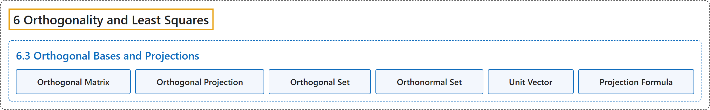

# 6.3 Orthogonal Bases and Projections

## Classification

## Glossary

| Term | Definition | 中文翻译 | Source |
|---|---|---|---|
| **6.3 Orthogonal Bases and Projections** 正交基与投影 | (No definition) | （无定义） | [Austin, 2023, section 6.3](https://understandinglinearalgebra.org/sec-orthogonal-bases.html) |
| **Orthogonal Matrix** 正交矩阵 | "A square $m\times m$ matrix $Q$ whose **columns form an orthonormal basis for $\mathbb{R}^m$** is called **orthogonal**." | **各列构成 $\mathbb{R}^m$ 的标准正交基**的 $m\times m$ 方阵 $Q$ 称为**正交矩阵**。 | [Austin, 2023, Definition 6.3.26](https://understandinglinearalgebra.org/sec-orthogonal-bases.html#sec-orthogonal-bases-5-26) |
| **Orthogonal Projection** 正交投影 | "Given a vector $\mathbf{b}$ in $\mathbb{R}^m$ and a subspace $W$ of $\mathbb{R}^m$, the **orthogonal projection** of $\mathbf{b}$ onto $W$ is the vector $\widehat{\mathbf{b}}$ in $W$ that is **closest to $\mathbf{b}$**." | 给定 $\mathbb{R}^m$ 中的向量 $\mathbf{b}$ 和 $\mathbb{R}^m$ 的子空间 $W$，$\mathbf{b}$ 在 $W$ 上的**正交投影**是 $W$ 中**最接近 $\mathbf{b}$** 的向量 $\widehat{\mathbf{b}}$。 | [Austin, 2023, Definition 6.3.14](https://understandinglinearalgebra.org/sec-orthogonal-bases.html#sec-orthogonal-bases-5-8) |
| **Orthogonal Set** 正交集 | "By an **orthogonal set** of vectors, we mean a set of nonzero vectors each of which is **orthogonal to the others**." | 所谓向量的**正交集**，是指由非零向量组成、其中**每个向量都与其他向量正交**的集合。 | [Austin, 2023, Definition 6.3.2](https://understandinglinearalgebra.org/sec-orthogonal-bases.html#sec-orthogonal-bases-4-3) |
| **Orthonormal Set** 标准正交集 | "An **orthonormal set** is an orthogonal set of vectors each of which has **unit length**." | **标准正交集**是其中每个向量都具有**单位长度**的正交向量集。 | [Austin, 2023, Definition 6.3.8](https://understandinglinearalgebra.org/sec-orthogonal-bases.html#sec-orthogonal-bases-4-15) |
| **Unit Vector** 单位向量 | "Such vectors are called **unit vectors**." | 这样的向量称为**单位向量**。 | [Austin, 2023, section 6.3](https://understandinglinearalgebra.org/sec-orthogonal-bases.html#sec-orthogonal-bases-4-12-1-1-2-4) |
| **Projection Formula** 投影公式 | "If $W$ is a subspace of $\mathbb{R}^m$ having an **orthogonal basis** $\mathbf{w}_1,\mathbf{w}_2,\ldots, \mathbf{w}_n$ and $\mathbf{b}$ is a vector in $\mathbb{R}^m$, then the **orthogonal projection** of $\mathbf{b}$ onto $W$ is $\widehat{\mathbf{b}}= \frac{\mathbf{b}\cdot\mathbf{w}_1}{\mathbf{w}_1\cdot\mathbf{w}_1}~\mathbf{w}_1 + \frac{\mathbf{b}\cdot\mathbf{w}_2}{\mathbf{w}_2\cdot\mathbf{w}_2}~\mathbf{w}_2 + \cdots + \frac{\mathbf{b}\cdot\mathbf{w}_n}{\mathbf{w}_n\cdot\mathbf{w}_n}~\mathbf{w}_n$." | 如果 $W$ 是 $\mathbb{R}^m$ 的子空间，具有**正交基** $\mathbf{w}_1,\mathbf{w}_2,\ldots, \mathbf{w}_n$，且 $\mathbf{b}$ 是 $\mathbb{R}^m$ 中的向量，则 $\mathbf{b}$ 在 $W$ 上的**正交投影**为 $\widehat{\mathbf{b}}= \frac{\mathbf{b}\cdot\mathbf{w}_1}{\mathbf{w}_1\cdot\mathbf{w}_1}~\mathbf{w}_1 + \frac{\mathbf{b}\cdot\mathbf{w}_2}{\mathbf{w}_2\cdot\mathbf{w}_2}~\mathbf{w}_2 + \cdots + \frac{\mathbf{b}\cdot\mathbf{w}_n}{\mathbf{w}_n\cdot\mathbf{w}_n}~\mathbf{w}_n$。 | [Austin, 2023, Proposition 6.3.18](https://understandinglinearalgebra.org/sec-orthogonal-bases.html#prop-proj-formula) |

## References

Austin, D. (2023). *Understanding linear algebra* (2023 update). Retrieved October 29, 2026, from <https://understandinglinearalgebra.org/home.html>
