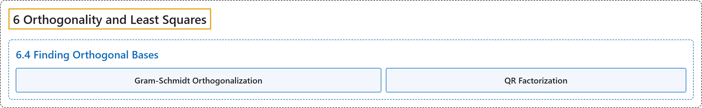

# 6.4 Finding Orthogonal Bases

## Classification

## Glossary

| Term | Definition | 中文翻译 | Source |
|---|---|---|---|
| **6.4 Finding Orthogonal Bases** 求正交基 | (No definition) | （无定义） | [Austin, 2023, section 6.4](https://understandinglinearalgebra.org/sec-gram-schmidt.html) |
| **Gram-Schmidt Orthogonalization** 格拉姆-施密特正交化 | "The preview activity illustrates the main idea behind an algorithm, known as **Gram-Schmidt orthogonalization**, that begins with a basis for some subspace of $\mathbb{R}^m$ and **produces an orthogonal or orthonormal basis**." | 预备活动说明了一个算法的主要思想，这个算法称为**格拉姆-施密特正交化**，它从 $\mathbb{R}^m$ 的某个子空间的一组基出发，**得到一组正交基或标准正交基**。 | [Austin, 2023, section 6.4](https://understandinglinearalgebra.org/sec-gram-schmidt.html#sec-gram-schmidt-4-2) |
| **QR Factorization** QR 分解 | "If $A$ is an $m\times n$ matrix whose columns are linearly independent, we may write **$A=QR$** where $Q$ is an $m\times n$ matrix whose columns form an **orthonormal basis for $\text{Col}(A)$** and $R$ is an $n\times n$ **upper triangular matrix**." | 如果 $A$ 是各列线性无关的 $m\times n$ 矩阵，则可以写成 **$A=QR$**，其中 $Q$ 是 $m\times n$ 矩阵，其各列构成 **$\text{Col}(A)$ 的标准正交基**，$R$ 是 $n\times n$ **上三角矩阵**。 | [Austin, 2023, Proposition 6.4.9](https://understandinglinearalgebra.org/sec-gram-schmidt.html#prop-qr) |

## References

Austin, D. (2023). *Understanding linear algebra* (2023 update). Retrieved October 29, 2026, from <https://understandinglinearalgebra.org/home.html>
