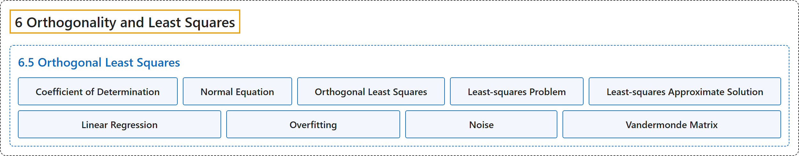

# 6.5 Orthogonal Least Squares

## Classification

## Glossary

| Term | Definition | 中文翻译 | Source |
|---|---|---|---|
| **6.5 Orthogonal Least Squares** 正交最小二乘 | (No definition) | （无定义） | [Austin, 2023, section 6.5](https://understandinglinearalgebra.org/sec-least-squares.html) |
| **Coefficient of Determination** 决定系数 | "The **coefficient of determination** is **$R^2 = 1 - \frac{\vert \mathbf{b} - A\widehat{\mathbf{x}}\vert ^2} {\vert \widetilde{\mathbf{b}}\vert ^2}$**, where $\widetilde{\mathbf{b}}$ is the vector obtained by demeaning $\mathbf{b}$." | **决定系数**为 **$R^2 = 1 - \frac{\vert \mathbf{b} - A\widehat{\mathbf{x}}\vert ^2} {\vert \widetilde{\mathbf{b}}\vert ^2}$**，其中 $\widetilde{\mathbf{b}}$ 是对 $\mathbf{b}$ 去均值得到的向量。 | [Austin, 2023, Definition 6.5.12](https://understandinglinearalgebra.org/sec-least-squares.html#sec-least-squares-5-14) |
| **Normal Equation** 正规方程 | "Because the least-squares approximate solution is the vector $\widehat{\mathbf{x}}$ such that $A\widehat{\mathbf{x}} = \widehat{\mathbf{b}}$, we can rearrange this equation to see that $\begin{aligned} A^T(A\widehat{\mathbf{x}} - \mathbf{b}) & = \mathbf{0}\\ A^TA\widehat{\mathbf{x}} - A^T\mathbf{b} & = \mathbf{0}\\ A^TA\widehat{\mathbf{x}} & = A^T\mathbf{b} \end{aligned}$. This equation is called the **normal equation**, and we have the following proposition." | 由于最小二乘近似解是满足 $A\widehat{\mathbf{x}} = \widehat{\mathbf{b}}$ 的向量 $\widehat{\mathbf{x}}$，我们可以把这个方程整理为 $\begin{aligned} A^T(A\widehat{\mathbf{x}} - \mathbf{b}) & = \mathbf{0}\\ A^TA\widehat{\mathbf{x}} - A^T\mathbf{b} & = \mathbf{0}\\ A^TA\widehat{\mathbf{x}} & = A^T\mathbf{b} \end{aligned}$。这个方程称为**正规方程**，由此得到下面的命题。 | [Austin, 2023, section 6.5](https://understandinglinearalgebra.org/sec-least-squares.html#sec-least-squares-5-5) |
| **Orthogonal Least Squares** 正交最小二乘 | "This activity illustrates the idea behind a technique known as **orthogonal least squares**, which we have been working toward throughout this chapter." | 这个活动说明了一种称为**正交最小二乘**的技术背后的思想，本章一直在为它做准备。 | [Austin, 2023, section 6.5](https://understandinglinearalgebra.org/sec-least-squares.html#sec-least-squares-4-4) |
| **Least-squares Problem** 最小二乘问题 | "Our approach finds the values for $b$ and $m$ that make **this sum of squares as small as possible**, which is why we call this a **least-squares problem**." | 我们的方法求出使**这个平方和尽可能小**的 $b$ 和 $m$ 的值，这就是我们称之为**最小二乘问题**的原因。 | [Austin, 2023, section 6.5](https://understandinglinearalgebra.org/sec-least-squares.html#sec-least-squares-4-6) |
| **Least-squares Approximate Solution** 最小二乘近似解 | "We will usually denote the **solution of $A\mathbf{x} = \widehat{\mathbf{b}}$** by $\widehat{\mathbf{x}}$ and call this vector the **least-squares approximate solution** of $A\mathbf{x}=\mathbf{b}$ to distinguish it from a (possibly non-existent) solution of $A\mathbf{x}=\mathbf{b}$." | 我们通常把 **$A\mathbf{x} = \widehat{\mathbf{b}}$ 的解**记为 $\widehat{\mathbf{x}}$，并称这个向量为 $A\mathbf{x}=\mathbf{b}$ 的**最小二乘近似解**，以区别于 $A\mathbf{x}=\mathbf{b}$ 的（可能不存在的）解。 | [Austin, 2023, section 6.5](https://understandinglinearalgebra.org/sec-least-squares.html#sec-least-squares-5-4) |
| **Linear Regression** 线性回归 | "This example demonstrates an approach, called **linear regression**, in which a collection of data is **modeled using a linear function found by solving a least-squares problem**." | 这个例子展示了一种称为**线性回归**的方法，在这种方法中，一组数据**用通过求解最小二乘问题得到的线性函数来建模**。 | [Austin, 2023, section 6.5](https://understandinglinearalgebra.org/sec-least-squares.html#sec-least-squares-5-9) |
| **Overfitting** 过拟合 | "Fitting the data with a polynomial whose **degree is too high** is called **overfitting**, a phenomenon that can appear in many machine learning applications." | 用**次数过高**的多项式拟合数据称为**过拟合**，这种现象可能出现在许多机器学习应用中。 | [Austin, 2023, section 6.5](https://understandinglinearalgebra.org/sec-least-squares.html#sec-least-squares-7-5-1-5-1-5-4) |
| **Noise** 噪声 | "The **error built in to the data** is called **noise**, and its presence means that we shouldn’t expect our polynomial to fit the data perfectly." | **数据中固有的误差**称为**噪声**，它的存在意味着我们不应指望多项式能完美地拟合数据。 | [Austin, 2023, section 6.5](https://understandinglinearalgebra.org/sec-least-squares.html#sec-least-squares-7-5-1-5-1-5-3) |
| **Vandermonde Matrix** 范德蒙德矩阵 | "This is called a **Vandermonde matrix** of degree $k$." | 这称为 $k$ 次**范德蒙德矩阵**。 | [Austin, 2023, section 6.5](https://understandinglinearalgebra.org/sec-least-squares.html#sec-least-squares-7-4) |

## References

Austin, D. (2023). *Understanding linear algebra* (2023 update). Retrieved October 29, 2026, from <https://understandinglinearalgebra.org/home.html>
