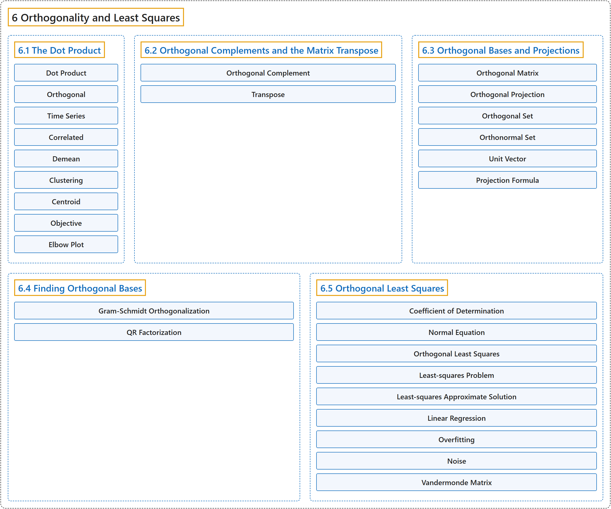

# 6 Orthogonality and Least Squares

## Classification

## Glossary

| Term | Definition | 中文翻译 | Source |
|---|---|---|---|
| **6 Orthogonality and Least Squares** 正交性与最小二乘 | (No definition) | （无定义） | [Austin, 2023, chapter 6](https://understandinglinearalgebra.org/chap6.html) |
| **[6.1 The Dot Product](6-1-the-dot-product.md)** 点积 | (No definition) | （无定义） | [Austin, 2023, section 6.1](https://understandinglinearalgebra.org/sec-dot-product.html) |
| **[6.2 Orthogonal Complements and the Matrix Transpose](6-2-orthogonal-complements-and-the-matrix-transpose.md)** 正交补与矩阵的转置 | (No definition) | （无定义） | [Austin, 2023, section 6.2](https://understandinglinearalgebra.org/sec-transpose.html) |
| **[6.3 Orthogonal Bases and Projections](6-3-orthogonal-bases-and-projections.md)** 正交基与投影 | (No definition) | （无定义） | [Austin, 2023, section 6.3](https://understandinglinearalgebra.org/sec-orthogonal-bases.html) |
| **[6.4 Finding Orthogonal Bases](6-4-finding-orthogonal-bases.md)** 求正交基 | (No definition) | （无定义） | [Austin, 2023, section 6.4](https://understandinglinearalgebra.org/sec-gram-schmidt.html) |
| **[6.5 Orthogonal Least Squares](6-5-orthogonal-least-squares.md)** 正交最小二乘 | (No definition) | （无定义） | [Austin, 2023, section 6.5](https://understandinglinearalgebra.org/sec-least-squares.html) |

## References

Austin, D. (2023). *Understanding linear algebra* (2023 update). Retrieved October 29, 2026, from <https://understandinglinearalgebra.org/home.html>
