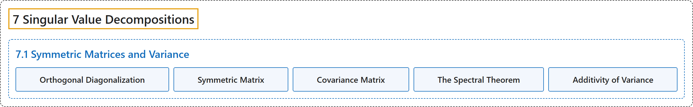

# 7.1 Symmetric Matrices and Variance

## Classification

## Glossary

| Term | Definition | 中文翻译 | Source |
|---|---|---|---|
| **7.1 Symmetric Matrices and Variance** 对称矩阵与方差 | (No definition) | （无定义） | [Austin, 2023, section 7.1](https://understandinglinearalgebra.org/sec-symmetric-matrices.html) |
| **Orthogonal Diagonalization** 正交对角化 | "If there is an **orthonormal basis of $\mathbb{R}^n$ consisting of eigenvectors** of the matrix $A$, we say that $A$ is **orthogonally diagonalizable**." | 如果 $\mathbb{R}^n$ 存在一组**由矩阵 $A$ 的特征向量构成的标准正交基**，则称 $A$ **可正交对角化**。 | [Austin, 2023, Definition 7.1.6](https://understandinglinearalgebra.org/sec-symmetric-matrices.html#def-orthog-diag) |
| **Symmetric Matrix** 对称矩阵 | "A **symmetric matrix** $A$ is one for which **$A=A^T$**." | **对称矩阵** $A$ 是满足 **$A=A^T$** 的矩阵。 | [Austin, 2023, Definition 7.1.7](https://understandinglinearalgebra.org/sec-symmetric-matrices.html#sec-symmetric-matrices-4-8) |
| **Covariance Matrix** 协方差矩阵 | "In general, the matrix **$C=\frac1N~AA^T$** is called the **covariance matrix** of the dataset, and it is useful because the variance $V_\mathbf{u} = \mathbf{u}\cdot(C\mathbf{u})$, as we have just seen." | 一般地，矩阵 **$C=\frac1N~AA^T$** 称为数据集的**协方差矩阵**，它很有用，因为正如我们刚才看到的，方差 $V_\mathbf{u} = \mathbf{u}\cdot(C\mathbf{u})$。 | [Austin, 2023, section 7.1](https://understandinglinearalgebra.org/sec-symmetric-matrices.html#sec-symmetric-matrices-5-10-1-2-3-4-1) |
| **The Spectral Theorem** 谱定理 | "The matrix $A$ is **orthogonally diagonalizable** if and only if $A$ is **symmetric**." | 矩阵 $A$ **可正交对角化**当且仅当 $A$ 是**对称的**。 | [Austin, 2023, Theorem 7.1.11](https://understandinglinearalgebra.org/sec-symmetric-matrices.html#sec-symmetric-matrices-4-12) |
| **Additivity of Variance** 方差的可加性 | "If $W$ is a subspace with orthonormal basis $\mathbf{u}_1$,$\mathbf{u}_2$,$\ldots$, $\mathbf{u}_n$, then the **variance of the points projected onto $W$** is the **sum of the variances in the $\mathbf{u}_j$ directions**: $V_W = V_{\mathbf{u}_1} + V_{\mathbf{u}_2} + \ldots + V_{\mathbf{u}_n}$." | 如果 $W$ 是具有标准正交基 $\mathbf{u}_1$、$\mathbf{u}_2$、$\ldots$、$\mathbf{u}_n$ 的子空间，那么**投影到 $W$ 上的点的方差**等于**各 $\mathbf{u}_j$ 方向上的方差之和**：$V_W = V_{\mathbf{u}_1} + V_{\mathbf{u}_2} + \ldots + V_{\mathbf{u}_n}$。 | [Austin, 2023, Proposition 7.1.20](https://understandinglinearalgebra.org/sec-symmetric-matrices.html#prop-variance-additivity) |

## References

Austin, D. (2023). *Understanding linear algebra* (2023 update). Retrieved October 29, 2026, from <https://understandinglinearalgebra.org/home.html>
