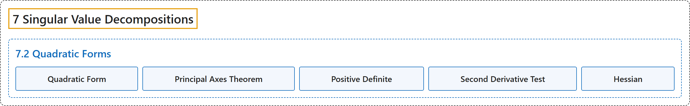

# 7.2 Quadratic Forms

## Classification

## Glossary

| Term | Definition | 中文翻译 | Source |
|---|---|---|---|
| **7.2 Quadratic Forms** 二次型 | (No definition) | （无定义） | [Austin, 2023, section 7.2](https://understandinglinearalgebra.org/sec-quadratic-forms.html) |
| **Quadratic Form** 二次型 | "If $A$ is a symmetric $m\times m$ matrix, the **quadratic form** defined by $A$ is the function **$q_A(\mathbf{x}) = \mathbf{x}\cdot(A\mathbf{x})$**." | 若 $A$ 是 $m\times m$ 对称矩阵，则由 $A$ 定义的**二次型**是函数 **$q_A(\mathbf{x}) = \mathbf{x}\cdot(A\mathbf{x})$**。 | [Austin, 2023, Definition 7.2.4](https://understandinglinearalgebra.org/sec-quadratic-forms.html#sec-quadratic-forms-4-5) |
| **Principal Axes Theorem** 主轴定理 | "If $A$ is a symmetric $m\times m$ matrix with eigenvalues $\lambda_1,\lambda_2,\ldots,\lambda_m$, then the quadratic form $q_A$ can be written, after an **orthogonal change of coordinates** $\mathbf{y}=Q^T\mathbf{x}$, as **$q_A(\mathbf{x}) = \lambda_1y_1^2 + \lambda_2y_2^2 + \ldots + \lambda_my_m^2$**." | 若 $A$ 是 $m\times m$ 对称矩阵，其特征值为 $\lambda_1,\lambda_2,\ldots,\lambda_m$，则经过**正交坐标变换** $\mathbf{y}=Q^T\mathbf{x}$ 后，二次型 $q_A$ 可写成 **$q_A(\mathbf{x}) = \lambda_1y_1^2 + \lambda_2y_2^2 + \ldots + \lambda_my_m^2$**。 | [Austin, 2023, Theorem 7.2.13](https://understandinglinearalgebra.org/sec-quadratic-forms.html#sec-quadratic-forms-4-21) |
| **Positive Definite** 正定 | "A symmetric matrix $A$ is called **positive definite** if its associated quadratic form satisfies **$q_A(\mathbf{x}) \gt 0$ for any nonzero vector $\mathbf{x}$**. If $q_A(\mathbf{x}) \geq 0$ for all nonzero vectors $\mathbf{x}$, we say that $A$ is **positive semidefinite**. Likewise, we say that $A$ is **negative definite** if $q_A(\mathbf{x}) \lt 0$ for all nonzero vectors $\mathbf{x}$. Finally, $A$ is called **indefinite** if $q_A(\mathbf{x}) \gt 0$ for some $\mathbf{x}$ and $q_A(\mathbf{x}) \lt 0$ for others." | 如果对称矩阵 $A$ 的相应二次型满足**对任意非零向量 $\mathbf{x}$ 都有 $q_A(\mathbf{x}) \gt 0$**，则称 $A$ 为**正定**的。如果对所有非零向量 $\mathbf{x}$ 都有 $q_A(\mathbf{x}) \geq 0$，则称 $A$ 为**半正定**的。类似地，如果对所有非零向量 $\mathbf{x}$ 都有 $q_A(\mathbf{x}) \lt 0$，则称 $A$ 为**负定**的。最后，如果对某些 $\mathbf{x}$ 有 $q_A(\mathbf{x}) \gt 0$，而对另一些 $\mathbf{x}$ 有 $q_A(\mathbf{x}) \lt 0$，则称 $A$ 为**不定**的。 | [Austin, 2023, Definition 7.2.14](https://understandinglinearalgebra.org/sec-quadratic-forms.html#sec-quadratic-forms-5-4) |
| **Second Derivative Test** 二阶导数判别法 | "The nature of a critical point of a multivariable function is determined by the **Hessian** $H$ of the function at the critical point. If $H$ has all positive eigenvalues, the critical point is a **local minimum**. $H$ has all negative eigenvalues, the critical point is a **local maximum**. $H$ has both positive and negative eigenvalues, the critical point is neither a local maximum nor minimum." | 多元函数临界点的性质由该函数在临界点处的**黑塞矩阵** $H$ 决定。如果 $H$ 的特征值全为正，则临界点是**局部极小值点**。如果 $H$ 的特征值全为负，则临界点是**局部极大值点**。如果 $H$ 既有正特征值又有负特征值，则临界点既不是局部极大值点也不是局部极小值点。 | [Austin, 2023, Proposition 7.2.18](https://understandinglinearalgebra.org/sec-quadratic-forms.html#sec-quadratic-forms-5-16) |
| **Hessian** 黑塞矩阵 | "The matrix $H = \begin{bmatrix} f_{xx}(x_0,y_0) & f_{xy}(x_0,y_0) \\ f_{yx}(x_0,y_0) & f_{yy}(x_0,y_0) \end{bmatrix}$ is called the **Hessian** of $f$, and we see now that the **eigenvalues of this symmetric matrix determine the nature of the critical point $(x_0,y_0)$**." | 矩阵 $H = \begin{bmatrix} f_{xx}(x_0,y_0) & f_{xy}(x_0,y_0) \\ f_{yx}(x_0,y_0) & f_{yy}(x_0,y_0) \end{bmatrix}$ 称为 $f$ 的**黑塞矩阵**，我们现在看到，这个对称矩阵的**特征值决定了临界点 $(x_0,y_0)$ 的性质**。 | [Austin, 2023, section 7.2](https://understandinglinearalgebra.org/sec-quadratic-forms.html#sec-quadratic-forms-5-14) |

## References

Austin, D. (2023). *Understanding linear algebra* (2023 update). Retrieved October 29, 2026, from <https://understandinglinearalgebra.org/home.html>
