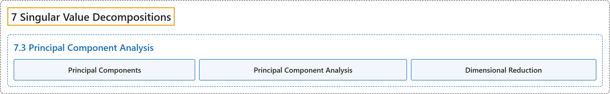

# 7.3 Principal Component Analysis

## Classification

## Glossary

| Term | Definition | 中文翻译 | Source |
|---|---|---|---|
| **7.3 Principal Component Analysis** 主成分分析 | (No definition) | （无定义） | [Austin, 2023, section 7.3](https://understandinglinearalgebra.org/sec-pca.html) |
| **Principal Components** 主成分 | "The **eigenvectors $\mathbf{u}_j$ of the covariance matrix** are called **principal components**, and we will order them so that their associated eigenvalues decrease." | **协方差矩阵的特征向量 $\mathbf{u}_j$** 称为**主成分**，我们将它们排序，使其对应的特征值递减。 | [Austin, 2023, section 7.3](https://understandinglinearalgebra.org/sec-pca.html#sec-pca-4-5) |
| **Principal Component Analysis** 主成分分析 | "This section explores a technique called **principal component analysis**, which enables us to **reduce the dimension of a dataset** so that it may be visualized or studied in a way so that interesting features more readily stand out." | 本节探讨一种称为**主成分分析**的技术，它使我们能够**降低数据集的维数**，以便将其可视化或加以研究，使有趣的特征更容易显现出来。 | [Austin, 2023, section 7.3](https://understandinglinearalgebra.org/sec-pca.html#sec-pca-2-2) |
| **Dimensional Reduction** 降维 | "Later in this section, we’ll see how to use this observation to work with the data **as if it were three-dimensional**, an idea known as **dimensional reduction**." | 在本节后面，我们将看到如何利用这一观察，**把数据当作三维数据来处理**，这一思想称为**降维**。 | [Austin, 2023, section 7.3](https://understandinglinearalgebra.org/sec-pca.html#sec-pca-4-4) |

## References

Austin, D. (2023). *Understanding linear algebra* (2023 update). Retrieved October 29, 2026, from <https://understandinglinearalgebra.org/home.html>
