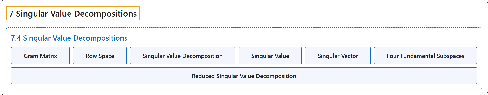

# 7.4 Singular Value Decompositions

## Classification

## Glossary

| Term | Definition | 中文翻译 | Source |
|---|---|---|---|
| **7.4 Singular Value Decompositions** 奇异值分解 | (No definition) | （无定义） | [Austin, 2023, section 7.4](https://understandinglinearalgebra.org/sec-svd-intro.html) |
| **Gram Matrix** 格拉姆矩阵 | "We call **$G=A^TA$**, the **Gram matrix** associated to $A$ and note that $l_A(\mathbf{x}) = \sqrt{q_G(\mathbf{x})}$." | 我们称 **$G=A^TA$** 为与 $A$ 相关的**格拉姆矩阵**，并注意到 $l_A(\mathbf{x}) = \sqrt{q_G(\mathbf{x})}$。 | [Austin, 2023, section 7.4](https://understandinglinearalgebra.org/sec-svd-intro.html#sec-svd-intro-4-5) |
| **Row Space** 行空间 | "Because **the columns of $A^T$ are the rows of $A$**, this subspace is sometimes called the **row space** of $A$ and denoted $\text{Row}(A)$." | 由于 **$A^T$ 的列就是 $A$ 的行**，这个子空间有时称为 $A$ 的**行空间**，记作 $\text{Row}(A)$。 | [Austin, 2023, section 7.4](https://understandinglinearalgebra.org/sec-svd-intro.html#sec-svd-intro-5-10) |
| **Singular Value Decomposition** 奇异值分解 | "An $m\times n$ matrix $A$ may be written as **$A=U\Sigma V^T$** where $U$ is an orthogonal $m\times m$ matrix, $V$ is an orthogonal $n\times n$ matrix, and $\Sigma$ is an $m\times n$ matrix whose entries are zero except for the **singular values** of $A$ which appear in decreasing order on the diagonal." | $m\times n$ 矩阵 $A$ 可以写成 **$A=U\Sigma V^T$**，其中 $U$ 是 $m\times m$ 正交矩阵，$V$ 是 $n\times n$ 正交矩阵，$\Sigma$ 是 $m\times n$ 矩阵，其元素除了按递减顺序排列在对角线上的 $A$ 的**奇异值**外均为零。 | [Austin, 2023, Theorem 7.4.8](https://understandinglinearalgebra.org/sec-svd-intro.html#theorem-svd) |
| **Singular Value** 奇异值 | "A general matrix, particularly a matrix that is not square, may not have eigenvalues and eigenvectors, but we can discover **analogous features**, called **singular values** and singular vectors, by studying a function somewhat similar to a quadratic form." | 一般矩阵，特别是非方阵，可能没有特征值和特征向量，但通过研究一个与二次型有些类似的函数，我们可以发现**类似的特征**，称为**奇异值**和奇异向量。 | [Austin, 2023, section 7.4](https://understandinglinearalgebra.org/sec-svd-intro.html#sec-svd-intro-4-4) |
| **Singular Vector** 奇异向量 | "A general matrix, particularly a matrix that is not square, may not have eigenvalues and eigenvectors, but we can discover **analogous features**, called singular values and **singular vectors**, by studying a function somewhat similar to a quadratic form." | 一般矩阵，特别是非方阵，可能没有特征值和特征向量，但通过研究一个与二次型有些类似的函数，我们可以发现**类似的特征**，称为奇异值和**奇异向量**。 | [Austin, 2023, section 7.4](https://understandinglinearalgebra.org/sec-svd-intro.html#sec-svd-intro-4-4) |
| **Four Fundamental Subspaces** 四个基本子空间 | "Considered altogether, the subspaces $\text{Col}(A)$, $\text{Nul}(A)$, $\text{Col}(A^T)$, and $\text{Nul}(A^T)$ are called the **four fundamental subspaces** associated to $A$." | 综合起来，子空间 $\text{Col}(A)$、$\text{Nul}(A)$、$\text{Col}(A^T)$ 和 $\text{Nul}(A^T)$ 称为与 $A$ 相关的**四个基本子空间**。 | [Austin, 2023, section 7.4](https://understandinglinearalgebra.org/sec-svd-intro.html#sec-svd-intro-5-11) |
| **Reduced Singular Value Decomposition** 简化奇异值分解 | "If $A$ is an $m\times n$ matrix having rank $r$, then **$A=U_r \Sigma_r V_r^T$** where $U_r$ is an $m\times r$ matrix whose columns form an orthonormal basis for $\text{Col}(A)$, $\Sigma_r=\begin{bmatrix} \sigma_1 & 0 & \ldots & 0 \\ 0 & \sigma_2 & \ldots & 0 \\ \vdots & \vdots & \ddots & \vdots \\ 0 & 0 & 0 & \sigma_r \\ \end{bmatrix}$ is an $r\times r$ **diagonal, invertible matrix**, and $V_r$ is an $n\times r$ matrix whose columns form an orthonormal basis for $\text{Col}(A^T)$." | 若 $A$ 是秩为 $r$ 的 $m\times n$ 矩阵，则 **$A=U_r \Sigma_r V_r^T$**，其中 $U_r$ 是 $m\times r$ 矩阵，其各列构成 $\text{Col}(A)$ 的标准正交基；$\Sigma_r=\begin{bmatrix} \sigma_1 & 0 & \ldots & 0 \\ 0 & \sigma_2 & \ldots & 0 \\ \vdots & \vdots & \ddots & \vdots \\ 0 & 0 & 0 & \sigma_r \\ \end{bmatrix}$ 是 $r\times r$ **可逆对角矩阵**；$V_r$ 是 $n\times r$ 矩阵，其各列构成 $\text{Col}(A^T)$ 的标准正交基。 | [Austin, 2023, Proposition 7.4.15](https://understandinglinearalgebra.org/sec-svd-intro.html#prop-reduced-svd) |

## References

Austin, D. (2023). *Understanding linear algebra* (2023 update). Retrieved October 29, 2026, from <https://understandinglinearalgebra.org/home.html>
