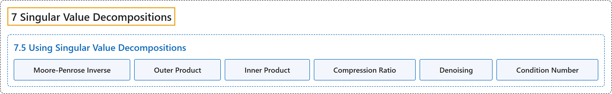

# 7.5 Using Singular Value Decompositions

## Classification

## Glossary

| Term | Definition | 中文翻译 | Source |
|---|---|---|---|
| **7.5 Using Singular Value Decompositions** 奇异值分解的应用 | (No definition) | （无定义） | [Austin, 2023, section 7.5](https://understandinglinearalgebra.org/sec-svd-uses.html) |
| **Moore-Penrose Inverse** 穆尔-彭罗斯广义逆 | "The matrix **$A^+ = V_r\Sigma_r^{-1}U_r^T$** is known as the **Moore-Penrose psuedoinverse** of $A$." | 矩阵 **$A^+ = V_r\Sigma_r^{-1}U_r^T$** 称为 $A$ 的**穆尔-彭罗斯伪逆**。 | [Austin, 2023, section 7.5](https://understandinglinearalgebra.org/sec-svd-uses.html#sec-svd-uses-4-10) |
| **Outer Product** 外积 | "Given two vectors $\mathbf{u}$ and $\mathbf{v}$, the matrix **$\mathbf{u}~\mathbf{v}^T$** is called the **outer product** of $\mathbf{u}$ and $\mathbf{v}$." | 给定两个向量 $\mathbf{u}$ 和 $\mathbf{v}$，矩阵 **$\mathbf{u}~\mathbf{v}^T$** 称为 $\mathbf{u}$ 与 $\mathbf{v}$ 的**外积**。 | [Austin, 2023, section 7.5](https://understandinglinearalgebra.org/sec-svd-uses.html#sec-svd-uses-5-7) |
| **Inner Product** 内积 | "(The **dot product** $\mathbf{u}\cdot\mathbf{v}=\mathbf{u}^T\mathbf{v}$ is sometimes called the **inner product**.)" | （**点积** $\mathbf{u}\cdot\mathbf{v}=\mathbf{u}^T\mathbf{v}$ 有时也称为**内积**。） | [Austin, 2023, section 7.5](https://understandinglinearalgebra.org/sec-svd-uses.html#sec-svd-uses-5-7) |
| **Compression Ratio** 压缩比 | "The **compression ratio** is the **ratio of the uncompressed size to the compressed size**." | **压缩比**是**未压缩大小与压缩后大小之比**。 | [Austin, 2023, section 7.5](https://understandinglinearalgebra.org/sec-svd-uses.html#sec-svd-uses-7-3-1-3-1-1-3-1-5-1) |
| **Denoising** 去噪 | "A second, related application of the singular value decomposition to image processing is called **denoising**." | 奇异值分解在图像处理中的第二个相关应用称为**去噪**。 | [Austin, 2023, section 7.5](https://understandinglinearalgebra.org/sec-svd-uses.html#sec-svd-uses-7-3-1-3-1-3-1) |
| **Condition Number** 条件数 | "In fact, we can measure how close a matrix is to being singular by forming the **condition number**, $\sigma_1/\sigma_n$, the **ratio of the largest to smallest singular value**." | 事实上，我们可以通过构造**条件数** $\sigma_1/\sigma_n$，即**最大奇异值与最小奇异值之比**，来度量一个矩阵与奇异矩阵的接近程度。 | [Austin, 2023, section 7.5](https://understandinglinearalgebra.org/sec-svd-uses.html#sec-svd-uses-10-8-1-2) |

## References

Austin, D. (2023). *Understanding linear algebra* (2023 update). Retrieved October 29, 2026, from <https://understandinglinearalgebra.org/home.html>
