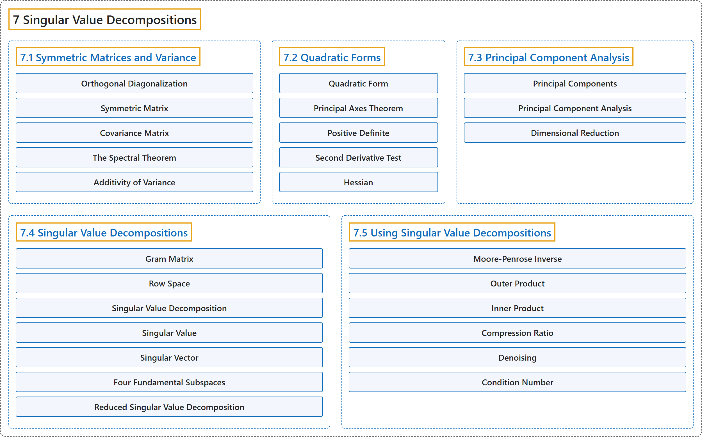

# 7 Singular Value Decompositions

## Classification

## Glossary

| Term | Definition | 中文翻译 | Source |
|---|---|---|---|
| **7 Singular Value Decompositions** 奇异值分解 | (No definition) | （无定义） | [Austin, 2023, chapter 7](https://understandinglinearalgebra.org/chap7.html) |
| **[7.1 Symmetric Matrices and Variance](7-1-symmetric-matrices-and-variance.md)** 对称矩阵与方差 | (No definition) | （无定义） | [Austin, 2023, section 7.1](https://understandinglinearalgebra.org/sec-symmetric-matrices.html) |
| **[7.2 Quadratic Forms](7-2-quadratic-forms.md)** 二次型 | (No definition) | （无定义） | [Austin, 2023, section 7.2](https://understandinglinearalgebra.org/sec-quadratic-forms.html) |
| **[7.3 Principal Component Analysis](7-3-principal-component-analysis.md)** 主成分分析 | (No definition) | （无定义） | [Austin, 2023, section 7.3](https://understandinglinearalgebra.org/sec-pca.html) |
| **[7.4 Singular Value Decompositions](7-4-singular-value-decompositions.md)** 奇异值分解 | (No definition) | （无定义） | [Austin, 2023, section 7.4](https://understandinglinearalgebra.org/sec-svd-intro.html) |
| **[7.5 Using Singular Value Decompositions](7-5-using-singular-value-decompositions.md)** 奇异值分解的应用 | (No definition) | （无定义） | [Austin, 2023, section 7.5](https://understandinglinearalgebra.org/sec-svd-uses.html) |

## References

Austin, D. (2023). *Understanding linear algebra* (2023 update). Retrieved October 29, 2026, from <https://understandinglinearalgebra.org/home.html>
