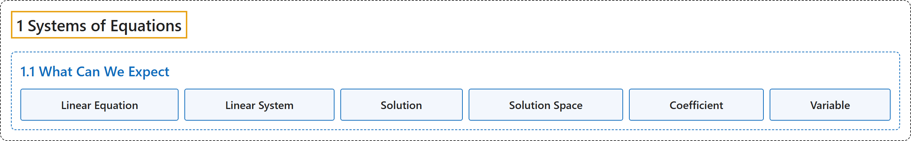

# 1.1 What Can We Expect

## Classification

## Glossary

| Term | Definition | 中文翻译 | Source |
|---|---|---|---|
| **1.1 What Can We Expect** 我们能期待什么 | (No definition) | （无定义） | [Austin, 2023, section 1.1](https://understandinglinearalgebra.org/sec-expect.html) |
| **Linear Equation** 线性方程 | "A **linear equation** in the unknowns $x_1,x_2,\ldots,x_n$ may be written **in the form $a_1x_1 + a_2x_2 + \ldots + a_nx_n = b$**, where $a_1,a_2,\ldots,a_n$ are real numbers known as coefficients." | 关于未知量 $x_1,x_2,\ldots,x_n$ 的**线性方程**可以写成**形如 $a_1x_1 + a_2x_2 + \ldots + a_nx_n = b$ 的形式**，其中 $a_1,a_2,\ldots,a_n$ 是称为系数的实数。 | [Austin, 2023, Definition 1.1.13](https://understandinglinearalgebra.org/sec-expect.html#sec-expect-4-5) |
| **Linear System** 线性方程组 | "By a **system of linear equations** or a **linear system**, we mean **a set of linear equations written in a common set of unknowns**." | 我们所说的**线性方程组**，是指**用一组共同的未知量写出的一组线性方程**。 | [Austin, 2023, Definition 1.1.13](https://understandinglinearalgebra.org/sec-expect.html#sec-expect-4-5) |
| **Solution** 解 | "A **solution** to a linear system is simply a set of numbers $x_1 = s_1, x_2 = s_2, \ldots, x_n=s_n$ that **satisfy all the equations in the system**." | 线性方程组的一个**解**就是**满足方程组中所有方程**的一组数 $x_1 = s_1, x_2 = s_2, \ldots, x_n=s_n$。 | [Austin, 2023, Definition 1.1.14](https://understandinglinearalgebra.org/sec-expect.html#sec-expect-4-7) |
| **Solution Space** 解空间 | "We call **the set of all solutions** the **solution space** of the linear system." | 我们把**全体解构成的集合**称为线性方程组的**解空间**。 | [Austin, 2023, Definition 1.1.15](https://understandinglinearalgebra.org/sec-expect.html#sec-expect-4-9) |
| **Coefficient** 系数 | "A linear equation in the unknowns $x_1,x_2,\ldots,x_n$ may be written in the form $a_1x_1 + a_2x_2 + \ldots + a_nx_n = b$, where $a_1,a_2,\ldots,a_n$ are **real numbers known as coefficients**." | 关于未知量 $x_1,x_2,\ldots,x_n$ 的线性方程可以写成形如 $a_1x_1 + a_2x_2 + \ldots + a_nx_n = b$ 的形式，其中 $a_1,a_2,\ldots,a_n$ 是**称为系数的实数**。 | [Austin, 2023, section 1.1](https://understandinglinearalgebra.org/sec-expect.html#sec-expect-4-5-1-1) |
| **Variable** 变量 | "We also say that $x_1,x_2,\ldots,x_n$ are the **variables** in the equation." | 我们也称 $x_1,x_2,\ldots,x_n$ 为方程中的**变量**。 | [Austin, 2023, section 1.1](https://understandinglinearalgebra.org/sec-expect.html#sec-expect-4-5-1-1) |

## References

Austin, D. (2023). *Understanding linear algebra* (2023 update). Retrieved October 29, 2026, from <https://understandinglinearalgebra.org/home.html>
