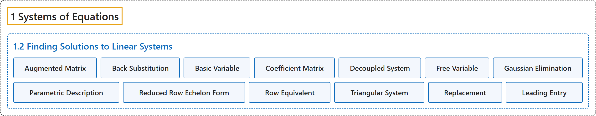

# 1.2 Finding Solutions to Linear Systems

## Classification

## Glossary

| Term | Definition | 中文翻译 | Source |
|---|---|---|---|
| **1.2 Finding Solutions to Linear Systems** 求线性方程组的解 | (No definition) | （无定义） | [Austin, 2023, section 1.2](https://understandinglinearalgebra.org/sec-finding-solutions.html) |
| **Augmented Matrix** 增广矩阵 | "We then construct an **augmented matrix** by simply **forgetting about the variables and recording the numerical data in a rectangular array**." | 然后，我们只需**略去变量，把数值数据记录在一个矩形阵列中**，就构造出了**增广矩阵**。 | [Austin, 2023, section 1.2](https://understandinglinearalgebra.org/sec-finding-solutions.html#sec-finding-solutions-4-3) |
| **Back Substitution** 回代 | "As this example demonstrates, **triangular systems** are easily solved by this process, which is called **back substitution**." | 正如这个例子所示，**三角形方程组**很容易用这一过程求解，这一过程称为**回代**。 | [Austin, 2023, Observation 1.2.3](https://understandinglinearalgebra.org/sec-finding-solutions.html#sec-finding-solutions-3-6) |
| **Basic Variable** 基本变量 | "The variables $x$ and $y$ are called **basic variables** as they are **determined once we make a choice of the free variable**." | 变量 $x$ 和 $y$ 称为**基本变量**，因为**一旦选定自由变量的取值，它们就随之确定**。 | [Austin, 2023, section 1.2](https://understandinglinearalgebra.org/sec-finding-solutions.html#sec-finding-solutions-5-9-2-1-1) |
| **Coefficient Matrix** 系数矩阵 | "We sometimes choose to **focus only on the coefficients of the system** in which case we write the **coefficient matrix** as $\left[ \begin{array}{rrr} -1 & -2 & 2 \\ 2 & 4 & -1 \\ 1 & 2 & 0 \\ \end{array} \right]$." | 有时我们选择**只关注方程组的系数**，此时把**系数矩阵**写成 $\left[ \begin{array}{rrr} -1 & -2 & 2 \\ 2 & 4 & -1 \\ 1 & 2 & 0 \\ \end{array} \right]$。 | [Austin, 2023, section 1.2](https://understandinglinearalgebra.org/sec-finding-solutions.html#sec-finding-solutions-4-5) |
| **Decoupled System** 解耦方程组 | "We call such a system **decoupled**." | 我们称这样的方程组是**解耦的**。 | [Austin, 2023, Observation 1.2.2](https://understandinglinearalgebra.org/sec-finding-solutions.html#sec-finding-solutions-3-5) |
| **Free Variable** 自由变量 | "Because there is **no restriction on the value of $z$**, we call it a **free variable**, and note that the linear system has infinitely many solutions." | 由于**对 $z$ 的取值没有限制**，我们称它为**自由变量**，并注意到该线性方程组有无穷多个解。 | [Austin, 2023, section 1.2](https://understandinglinearalgebra.org/sec-finding-solutions.html#sec-finding-solutions-5-9-2-1-1) |
| **Gaussian Elimination** 高斯消元法 | "We will develop an algorithm, which is usually called **Gaussian elimination**, that allows us to **describe the solution space of a linear system**." | 我们将建立一种通常称为**高斯消元法**的算法，用它可以**描述线性方程组的解空间**。 | [Austin, 2023, section 1.2](https://understandinglinearalgebra.org/sec-finding-solutions.html#sec-finding-solutions-3-2) |
| **Parametric Description** 参数表示 | "We will call this description of the solution space, in which the **basic variables are written in terms of the free variables**, a **parametric description** of the solution space." | 我们把解空间的这种**用自由变量表示基本变量**的描述称为解空间的**参数表示**。 | [Austin, 2023, section 1.2](https://understandinglinearalgebra.org/sec-finding-solutions.html#sec-finding-solutions-5-9-2-1-1) |
| **Reduced Row Echelon Form** 行最简形 | "We say that a matrix is in **reduced row echelon form** if the following properties are satisfied. We call a matrix in reduced row echelon form a **reduced row echelon matrix**." | 如果一个矩阵满足下列性质，就称它是**行最简形**。我们把行最简形的矩阵称为**行最简形矩阵**。 | [Austin, 2023, Definition 1.2.8](https://understandinglinearalgebra.org/sec-finding-solutions.html#reduced-row-echelon) |
| **Row Equivalent** 行等价 | "Since these operations **act on the rows of the matrices**, we say that the matrices are **row equivalent**." | 由于这些运算**作用在矩阵的行上**，我们说这些矩阵是**行等价的**。 | [Austin, 2023, section 1.2](https://understandinglinearalgebra.org/sec-finding-solutions.html#sec-finding-solutions-4-7) |
| **Triangular System** 三角形方程组 | "Our original system, $\begin{alignedat}{4} x & {} + {} & 2y & {}-{} & 2z & {}={} & -4 \\ & & -y & {}+{} & z & {}={} & 3 \\ & & & & 3z & {}={} & 3, \\ \end{alignedat}$ is called a **triangular system** due to **the shape formed by the coefficients**." | 我们原来的方程组 $\begin{alignedat}{4} x & {} + {} & 2y & {}-{} & 2z & {}={} & -4 \\ & & -y & {}+{} & z & {}={} & 3 \\ & & & & 3z & {}={} & 3, \\ \end{alignedat}$ 因**其系数排成的形状**而称为**三角形方程组**。 | [Austin, 2023, Observation 1.2.3](https://understandinglinearalgebra.org/sec-finding-solutions.html#sec-finding-solutions-3-6) |
| **Replacement** 倍加变换 | "We call this process **replacement**." | 我们称这一过程为**倍加变换**。 | [Austin, 2023, section 1.2](https://understandinglinearalgebra.org/sec-finding-solutions.html#sec-finding-solutions-3-8-1-3-2) |
| **Leading Entry** 首非零元 | "We call this entry the **leading entry** in the row." | 我们称这个元素为该行的**首非零元**。 | [Austin, 2023, section 1.2](https://understandinglinearalgebra.org/sec-finding-solutions.html#reduced-row-echelon-1-1-3-2-1) |

## References

Austin, D. (2023). *Understanding linear algebra* (2023 update). Retrieved October 29, 2026, from <https://understandinglinearalgebra.org/home.html>
