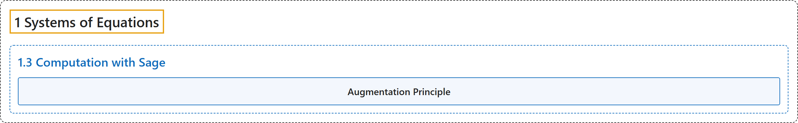

# 1.3 Computation with Sage

## Classification

## Glossary

| Term | Definition | 中文翻译 | Source |
|---|---|---|---|
| **1.3 Computation with Sage** 用 Sage 计算 | (No definition) | （无定义） | [Austin, 2023, section 1.3](https://understandinglinearalgebra.org/sec-sage-introduction.html) |
| **Augmentation Principle** 增广原理 | "If matrix $B$ is **an augmentation of matrix $A$**, then **the reduced row echelon form of $B$ is an augmentation of the reduced row echelon form of $A$**." | 如果矩阵 $B$ 是**矩阵 $A$ 的增广**，那么 **$B$ 的行最简形是 $A$ 的行最简形的增广**。 | [Austin, 2023, Proposition 1.3.3](https://understandinglinearalgebra.org/sec-sage-introduction.html#principle-augmentation-principle) |

## References

Austin, D. (2023). *Understanding linear algebra* (2023 update). Retrieved October 29, 2026, from <https://understandinglinearalgebra.org/home.html>
