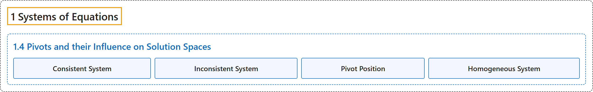

# 1.4 Pivots and their Influence on Solution Spaces

## Classification

## Glossary

| Term | Definition | 中文翻译 | Source |
|---|---|---|---|
| **1.4 Pivots and their Influence on Solution Spaces** 主元及其对解空间的影响 | (No definition) | （无定义） | [Austin, 2023, section 1.4](https://understandinglinearalgebra.org/sec-pivots.html) |
| **Consistent System** 相容方程组 | "Is there **a solution to the linear system**? If so, we say that the system is **consistent**; if not, we say it is inconsistent." | 线性方程组**有解**吗？如果有，我们说该方程组是**相容的**；如果没有，就说它是不相容的。 | [Austin, 2023, section 1.4](https://understandinglinearalgebra.org/sec-pivots.html#fundamental-questions-2-1-1) |
| **Inconsistent System** 不相容方程组 | "Is there **a solution to the linear system**? If so, we say that the system is consistent; if not, we say it is **inconsistent**." | 线性方程组**有解**吗？如果有，我们说该方程组是相容的；如果没有，就说它是**不相容的**。 | [Austin, 2023, section 1.4](https://understandinglinearalgebra.org/sec-pivots.html#fundamental-questions-2-1-1) |
| **Pivot Position** 主元位置 | "A **pivot position** in a matrix $A$ is **the position of a leading entry in the reduced row echelon matrix of $A$**." | 矩阵 $A$ 中的**主元位置**是指 **$A$ 的行最简形矩阵中首非零元所在的位置**。 | [Austin, 2023, Definition 1.4.1](https://understandinglinearalgebra.org/sec-pivots.html#sec-pivots-3-3) |
| **Homogeneous System** 齐次方程组 | "A linear system where **the right hand side of every equation is 0** is called **homogeneous**." | **每个方程的右端都为 0** 的线性方程组称为**齐次的**。 | [Austin, 2023, section 1.4](https://understandinglinearalgebra.org/sec-pivots.html#sec-pivots-7-8-1-1) |

## References

Austin, D. (2023). *Understanding linear algebra* (2023 update). Retrieved October 29, 2026, from <https://understandinglinearalgebra.org/home.html>
