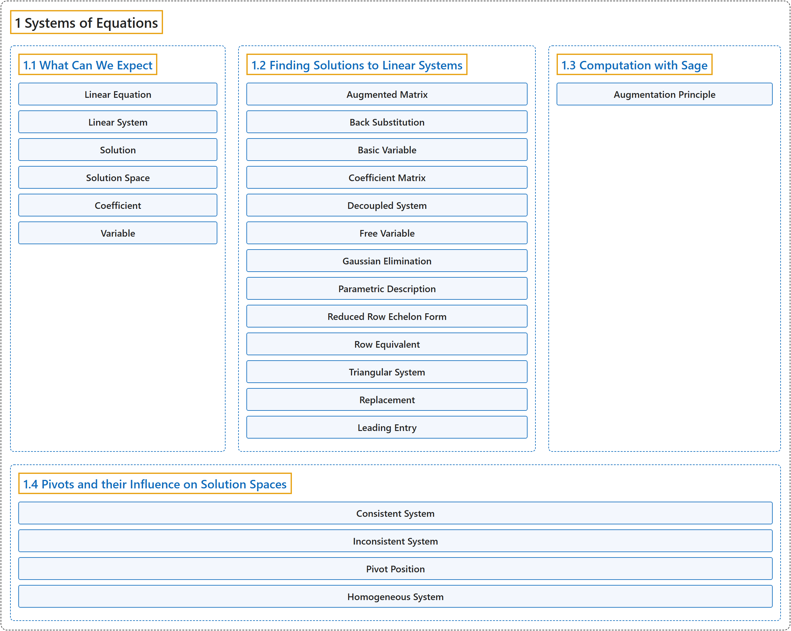

# 1 Systems of Equations

## Classification

## Glossary

| Term | Definition | 中文翻译 | Source |
|---|---|---|---|
| **1 Systems of Equations** 线性方程组 | (No definition) | （无定义） | [Austin, 2023, chapter 1](https://understandinglinearalgebra.org/chap1.html) |
| **[1.1 What Can We Expect](1-1-what-can-we-expect.md)** 我们能期待什么 | (No definition) | （无定义） | [Austin, 2023, section 1.1](https://understandinglinearalgebra.org/sec-expect.html) |
| **[1.2 Finding Solutions to Linear Systems](1-2-finding-solutions-to-linear-systems.md)** 求线性方程组的解 | (No definition) | （无定义） | [Austin, 2023, section 1.2](https://understandinglinearalgebra.org/sec-finding-solutions.html) |
| **[1.3 Computation with Sage](1-3-computation-with-sage.md)** 用 Sage 计算 | (No definition) | （无定义） | [Austin, 2023, section 1.3](https://understandinglinearalgebra.org/sec-sage-introduction.html) |
| **[1.4 Pivots and their Influence on Solution Spaces](1-4-pivots-and-their-influence-on-solution-spaces.md)** 主元及其对解空间的影响 | (No definition) | （无定义） | [Austin, 2023, section 1.4](https://understandinglinearalgebra.org/sec-pivots.html) |

## References

Austin, D. (2023). *Understanding linear algebra* (2023 update). Retrieved October 29, 2026, from <https://understandinglinearalgebra.org/home.html>
