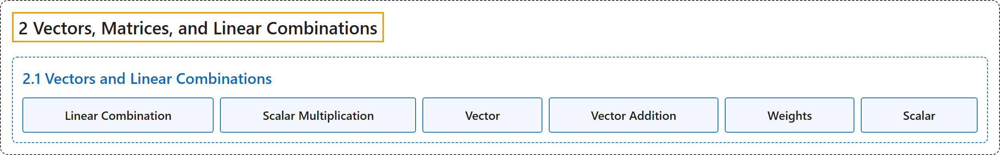

# 2.1 Vectors and Linear Combinations

## Classification

## Glossary

| Term | Definition | 中文翻译 | Source |
|---|---|---|---|
| **2.1 Vectors and Linear Combinations** 向量与线性组合 | (No definition) | （无定义） | [Austin, 2023, section 2.1](https://understandinglinearalgebra.org/sec-vectors-lin-combs.html) |
| **Linear Combination** 线性组合 | "The **linear combination** of the vectors $\mathbf{v}_1,\mathbf{v}_2,\ldots,\mathbf{v}_n$ with scalars $c_1,c_2,\ldots,c_n$ is **the vector $c_1\mathbf{v}_1 + c_2\mathbf{v}_2 + \ldots + c_n\mathbf{v}_n$**." | 向量 $\mathbf{v}_1,\mathbf{v}_2,\ldots,\mathbf{v}_n$ 以 $c_1,c_2,\ldots,c_n$ 为标量的**线性组合**是**向量 $c_1\mathbf{v}_1 + c_2\mathbf{v}_2 + \ldots + c_n\mathbf{v}_n$**。 | [Austin, 2023, Definition 2.1.10](https://understandinglinearalgebra.org/sec-vectors-lin-combs.html#sec-vectors-lin-combs-4-3) |
| **Scalar Multiplication** 数乘 | "We **multiply a vector $\mathbf{v}$ by a real number $c$** by **multiplying each of the components of $\mathbf{v}$ by $c$**." | 我们**用实数 $c$ 乘向量 $\mathbf{v}$** 的方法是**把 $\mathbf{v}$ 的每个分量都乘以 $c$**。 | [Austin, 2023, section 2.1](https://understandinglinearalgebra.org/sec-vectors-lin-combs.html#sec-vectors-lin-combs-3-7-1-1) |
| **Vector** 向量 | "A **vector** is most simply thought of as **a matrix with a single column**." | 最简单地说，**向量**可以看作**只有一列的矩阵**。 | [Austin, 2023, section 2.1](https://understandinglinearalgebra.org/sec-vectors-lin-combs.html#sec-vectors-lin-combs-3-2) |
| **Vector Addition** 向量加法 | "We **add two vectors of the same dimension** by **adding their components**." | **两个同维向量相加**，就是**把它们的分量分别相加**。 | [Austin, 2023, section 2.1](https://understandinglinearalgebra.org/sec-vectors-lin-combs.html#sec-vectors-lin-combs-3-7-1-2) |
| **Weights** 权重 | "The scalars $c_1,c_2,\ldots,c_n$ are called the **weights** of the linear combination." | 标量 $c_1,c_2,\ldots,c_n$ 称为该线性组合的**权重**。 | [Austin, 2023, Definition 2.1.10](https://understandinglinearalgebra.org/sec-vectors-lin-combs.html#sec-vectors-lin-combs-4-3) |
| **Scalar** 标量 | "We will frequently refer to **real numbers**, such as -3 in this example, as **scalars** to **distinguish them from vectors**." | 我们常把**实数**（比如本例中的 -3）称为**标量**，以**区别于向量**。 | [Austin, 2023, section 2.1](https://understandinglinearalgebra.org/sec-vectors-lin-combs.html#sec-vectors-lin-combs-3-7-1-1-3) |

## References

Austin, D. (2023). *Understanding linear algebra* (2023 update). Retrieved October 29, 2026, from <https://understandinglinearalgebra.org/home.html>
