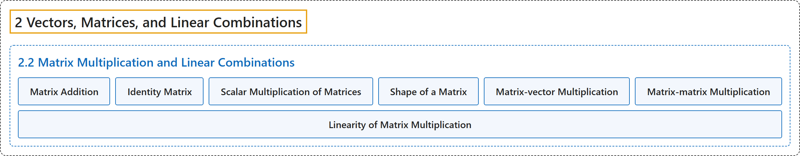

# 2.2 Matrix Multiplication and Linear Combinations

## Classification

## Glossary

| Term | Definition | 中文翻译 | Source |
|---|---|---|---|
| **2.2 Matrix Multiplication and Linear Combinations** 矩阵乘法与线性组合 | (No definition) | （无定义） | [Austin, 2023, section 2.2](https://understandinglinearalgebra.org/sec-matrices-lin-combs.html) |
| **Matrix Addition** 矩阵加法 | "This means that we may define scalar multiplication and **matrix addition** operations **using the corresponding column-wise vector operations**." | 这意味着我们可以**利用相应的按列向量运算**来定义数乘和**矩阵加法**运算。 | [Austin, 2023, section 2.2](https://understandinglinearalgebra.org/sec-matrices-lin-combs.html#sec-matrices-lin-combs-3-4) |
| **Identity Matrix** 单位矩阵 | "The matrix $I_n$, which we call the **identity matrix**, is the $n\times n$ matrix whose entries are **zero except for the diagonal entries, all of which are 1**." | 矩阵 $I_n$ 称为**单位矩阵**，它是**除对角元全为 1 外其余元素都为零**的 $n\times n$ 矩阵。 | [Austin, 2023, Exploration 2.2.1](https://understandinglinearalgebra.org/sec-matrices-lin-combs.html#ula-preview-2-2) |
| **Scalar Multiplication of Matrices** 矩阵的数乘 | "This means that we may define **scalar multiplication** and matrix addition operations **using the corresponding column-wise vector operations**." | 这意味着我们可以**利用相应的按列向量运算**来定义**数乘**和矩阵加法运算。 | [Austin, 2023, section 2.2](https://understandinglinearalgebra.org/sec-matrices-lin-combs.html#sec-matrices-lin-combs-3-4) |
| **Shape of a Matrix** 矩阵的形状 | "If we say that the **shape** of a matrix is $m\times n$, we mean that it **has $m$ rows and $n$ columns**." | 说一个矩阵的**形状**是 $m\times n$，是指它**有 $m$ 行 $n$ 列**。 | [Austin, 2023, section 2.2](https://understandinglinearalgebra.org/sec-matrices-lin-combs.html#sec-matrices-lin-combs-3-2) |
| **Matrix-vector Multiplication** 矩阵与向量的乘法 | "The **product of a matrix $A$ by a vector $\mathbf{x}$** will be **the linear combination of the columns of $A$ using the components of $\mathbf{x}$ as weights**. More specifically, if $A=\left[\begin{array}{rrrr} \mathbf{v}_1 & \mathbf{v}_2 & \ldots & \mathbf{v}_n \end{array}\right],~~~ \mathbf{x} = \left[\begin{array}{r} c_1 \\ c_2 \\ \vdots \\ c_n \end{array}\right]$, then $A\mathbf{x} = c_1\mathbf{v}_1 + c_2\mathbf{v}_2 + \ldots + c_n\mathbf{v}_n$. If $A$ is an $m\times n$ matrix, then $\mathbf{x}$ must be an $n$-dimensional vector, and the product $A\mathbf{x}$ will be an $m$-dimensional vector." | **矩阵 $A$ 与向量 $\mathbf{x}$ 的乘积**将是**以 $\mathbf{x}$ 的分量为权重的 $A$ 的各列的线性组合**。更具体地说，如果 $A=\left[\begin{array}{rrrr} \mathbf{v}_1 & \mathbf{v}_2 & \ldots & \mathbf{v}_n \end{array}\right],~~~ \mathbf{x} = \left[\begin{array}{r} c_1 \\ c_2 \\ \vdots \\ c_n \end{array}\right]$，那么 $A\mathbf{x} = c_1\mathbf{v}_1 + c_2\mathbf{v}_2 + \ldots + c_n\mathbf{v}_n$。如果 $A$ 是 $m\times n$ 矩阵，那么 $\mathbf{x}$ 必须是 $n$ 维向量，而乘积 $A\mathbf{x}$ 将是 $m$ 维向量。 | [Austin, 2023, Definition 2.2.3](https://understandinglinearalgebra.org/sec-matrices-lin-combs.html#sec-matrices-lin-combs-4-5) |
| **Matrix-matrix Multiplication** 矩阵乘法 | "Given matrices $A$ and $B$, we form **their product $AB$** by first **writing $B$ in terms of its columns** $B = \left[\begin{array}{rrrr} \mathbf{v}_1 & \mathbf{v}_2 & \cdots & \mathbf{v}_p \end{array}\right]$ and then defining $AB = \left[\begin{array}{rrrr} A\mathbf{v}_1 & A\mathbf{v}_2 & \cdots & A\mathbf{v}_p \end{array}\right]$." | 给定矩阵 $A$ 和 $B$，我们这样构造**它们的乘积 $AB$**：先**把 $B$ 按列写成** $B = \left[\begin{array}{rrrr} \mathbf{v}_1 & \mathbf{v}_2 & \cdots & \mathbf{v}_p \end{array}\right]$，然后定义 $AB = \left[\begin{array}{rrrr} A\mathbf{v}_1 & A\mathbf{v}_2 & \cdots & A\mathbf{v}_p \end{array}\right]$。 | [Austin, 2023, Definition 2.2.10](https://understandinglinearalgebra.org/sec-matrices-lin-combs.html#sec-matrices-lin-combs-6-3) |
| **Linearity of Matrix Multiplication** 矩阵乘法的线性性 | "If $A$ is a matrix, $\mathbf{v}$ and $\mathbf{w}$ vectors of the appropriate dimensions, and $c$ a scalar, then $A\mathbf{0} = \mathbf{0}$. **$A(c\mathbf{v}) = cA\mathbf{v}$**. **$A(\mathbf{v}+\mathbf{w}) = A\mathbf{v} + A\mathbf{w}$**." | 若 $A$ 是矩阵，$\mathbf{v}$ 和 $\mathbf{w}$ 是维数适当的向量，$c$ 是标量，则 $A\mathbf{0} = \mathbf{0}$。**$A(c\mathbf{v}) = cA\mathbf{v}$**。**$A(\mathbf{v}+\mathbf{w}) = A\mathbf{v} + A\mathbf{w}$**。 | [Austin, 2023, Proposition 2.2.6](https://understandinglinearalgebra.org/sec-matrices-lin-combs.html#prop-matrix-mult-prop) |

## References

Austin, D. (2023). *Understanding linear algebra* (2023 update). Retrieved October 29, 2026, from <https://understandinglinearalgebra.org/home.html>
