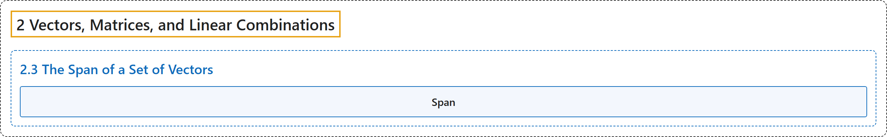

# 2.3 The Span of a Set of Vectors

## Classification

## Glossary

| Term | Definition | 中文翻译 | Source |
|---|---|---|---|
| **2.3 The Span of a Set of Vectors** 向量组的张成 | (No definition) | （无定义） | [Austin, 2023, section 2.3](https://understandinglinearalgebra.org/sec-span.html) |
| **Span** 张成 | "The **span** of a set of vectors $\mathbf{v}_1,\mathbf{v}_2,\ldots,\mathbf{v}_n$ is **the set of all linear combinations that can be formed from the vectors**. Alternatively, if $A = \begin{bmatrix} \mathbf{v}_1 & \mathbf{v}_2 & \cdots & \mathbf{v}_n \end{bmatrix}$, then the span of the vectors consists of all vectors $\mathbf{b}$ for which the equation $A\mathbf{x} = \mathbf{b}$ is consistent." | 向量组 $\mathbf{v}_1,\mathbf{v}_2,\ldots,\mathbf{v}_n$ 的**张成**是**由这些向量所能构成的全体线性组合的集合**。另一种说法是，如果 $A = \begin{bmatrix} \mathbf{v}_1 & \mathbf{v}_2 & \cdots & \mathbf{v}_n \end{bmatrix}$，那么这些向量的张成由使方程 $A\mathbf{x} = \mathbf{b}$ 相容的所有向量 $\mathbf{b}$ 组成。 | [Austin, 2023, Definition 2.3.2](https://understandinglinearalgebra.org/sec-span.html#sec-span-4-4) |

## References

Austin, D. (2023). *Understanding linear algebra* (2023 update). Retrieved October 29, 2026, from <https://understandinglinearalgebra.org/home.html>
