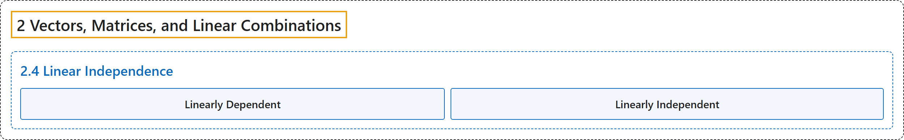

# 2.4 Linear Independence

## Classification

## Glossary

| Term | Definition | 中文翻译 | Source |
|---|---|---|---|
| **2.4 Linear Independence** 线性无关 | (No definition) | （无定义） | [Austin, 2023, section 2.4](https://understandinglinearalgebra.org/sec-linear-dep.html) |
| **Linearly Dependent** 线性相关 | "A set of vectors is called **linearly dependent** if **one of the vectors is a linear combination of the others**." | 如果一组向量中**有一个向量是其余向量的线性组合**，就称这组向量**线性相关**。 | [Austin, 2023, Definition 2.4.6](https://understandinglinearalgebra.org/sec-linear-dep.html#definition-linear-independence) |
| **Linearly Independent** 线性无关 | "**Otherwise**, the set of vectors is called **linearly independent**." | **否则**，就称这组向量**线性无关**。 | [Austin, 2023, Definition 2.4.6](https://understandinglinearalgebra.org/sec-linear-dep.html#definition-linear-independence) |

## References

Austin, D. (2023). *Understanding linear algebra* (2023 update). Retrieved October 29, 2026, from <https://understandinglinearalgebra.org/home.html>
