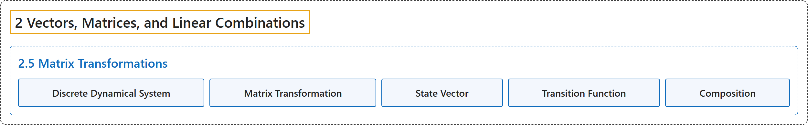

# 2.5 Matrix Transformations

## Classification

## Glossary

| Term | Definition | 中文翻译 | Source |
|---|---|---|---|
| **2.5 Matrix Transformations** 矩阵变换 | (No definition) | （无定义） | [Austin, 2023, section 2.5](https://understandinglinearalgebra.org/sec-linear-trans.html) |
| **Discrete Dynamical System** 离散动力系统 | "We call this situation where **the state of a system evolves from one time to the next according to the rule $\mathbf{x}_{k+1}=A\mathbf{x}_k$** a **discrete dynamical system**." | 我们把这种**系统状态按规则 $\mathbf{x}_{k+1}=A\mathbf{x}_k$ 从一个时刻演化到下一个时刻**的情形称为**离散动力系统**。 | [Austin, 2023, section 2.5](https://understandinglinearalgebra.org/sec-linear-trans.html#subsec-dynamical-systems-6) |
| **Matrix Transformation** 矩阵变换 | "The **matrix transformation** associated to the matrix $A$ is **the function that assigns to the vector $\mathbf{x}$ the vector $A\mathbf{x}$**; that is, $T(\mathbf{x}) = A\mathbf{x}$." | 与矩阵 $A$ 相关联的**矩阵变换**是**把向量 $\mathbf{x}$ 对应到向量 $A\mathbf{x}$ 的函数**；即 $T(\mathbf{x}) = A\mathbf{x}$。 | [Austin, 2023, Definition 2.5.4](https://understandinglinearalgebra.org/sec-linear-trans.html#sec-linear-trans-4-4) |
| **State Vector** 状态向量 | "We call $\mathbf{x}$ the **state vector** and $T$ the transition function, as it describes the transition of the state vector from one time to the next." | 我们称 $\mathbf{x}$ 为**状态向量**，称 $T$ 为转移函数，因为它描述了状态向量从一个时刻到下一个时刻的转移。 | [Austin, 2023, section 2.5](https://understandinglinearalgebra.org/sec-linear-trans.html#subsec-dynamical-systems-4) |
| **Transition Function** 转移函数 | "We call $\mathbf{x}$ the state vector and $T$ the **transition function**, as it **describes the transition of the state vector from one time to the next**." | 我们称 $\mathbf{x}$ 为状态向量，称 $T$ 为**转移函数**，因为它**描述了状态向量从一个时刻到下一个时刻的转移**。 | [Austin, 2023, section 2.5](https://understandinglinearalgebra.org/sec-linear-trans.html#subsec-dynamical-systems-4) |
| **Composition** 复合 | "This process is called **function composition** and likely appeared in an earlier algebra course." | 这一过程称为**函数复合**，你很可能在以前的代数课程中见过。 | [Austin, 2023, section 2.5](https://understandinglinearalgebra.org/sec-linear-trans.html#sec-linear-trans-5-3) |

## References

Austin, D. (2023). *Understanding linear algebra* (2023 update). Retrieved October 29, 2026, from <https://understandinglinearalgebra.org/home.html>
