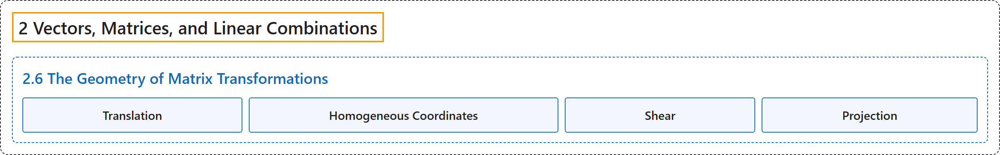

# 2.6 The Geometry of Matrix Transformations

## Classification

## Glossary

| Term | Definition | 中文翻译 | Source |
|---|---|---|---|
| **2.6 The Geometry of Matrix Transformations** 矩阵变换的几何 | (No definition) | （无定义） | [Austin, 2023, section 2.6](https://understandinglinearalgebra.org/sec-transforms-geom.html) |
| **Translation** 平移 | "Motions like this are called **translations**." | 这样的运动称为**平移**。 | [Austin, 2023, section 2.6](https://understandinglinearalgebra.org/sec-transforms-geom.html#sec-transforms-geom-5-6) |
| **Homogeneous Coordinates** 齐次坐标 | "To address this restriction, animators use **homogeneous coordinates**, which are formed by **placing the two-dimensional coordinate plane inside $\mathbb{R}^3$ as the plane $z=1$**, as shown in Figure 2.6.15." | 为了解决这一限制，动画师使用**齐次坐标**，其构造方法是**把二维坐标平面放入 $\mathbb{R}^3$ 中，作为平面 $z=1$**，如图 2.6.15 所示。 | [Austin, 2023, section 2.6](https://understandinglinearalgebra.org/sec-transforms-geom.html#sec-transforms-geom-5-8) |
| **Shear** 剪切变换 | "The matrix transformation $T:\mathbb{R}^2\to\mathbb{R}^2$ defined by the matrix $A= \left[\begin{array}{rr} 1& 1 \\ 0 & 1\\ \end{array}\right]$ is called a **shear**." | 由矩阵 $A= \left[\begin{array}{rr} 1& 1 \\ 0 & 1\\ \end{array}\right]$ 定义的矩阵变换 $T:\mathbb{R}^2\to\mathbb{R}^2$ 称为**剪切变换**。 | [Austin, 2023, section 2.6](https://understandinglinearalgebra.org/sec-transforms-geom.html#sec-transforms-geom-7-4-1-1-1-3-1) |
| **Projection** 投影 | "This transformation is called the **projection onto the horizontal axis**." | 这一变换称为**到水平轴上的投影**。 | [Austin, 2023, section 2.6](https://understandinglinearalgebra.org/sec-transforms-geom.html#sec-transforms-geom-7-6-1-1) |

## References

Austin, D. (2023). *Understanding linear algebra* (2023 update). Retrieved October 29, 2026, from <https://understandinglinearalgebra.org/home.html>
