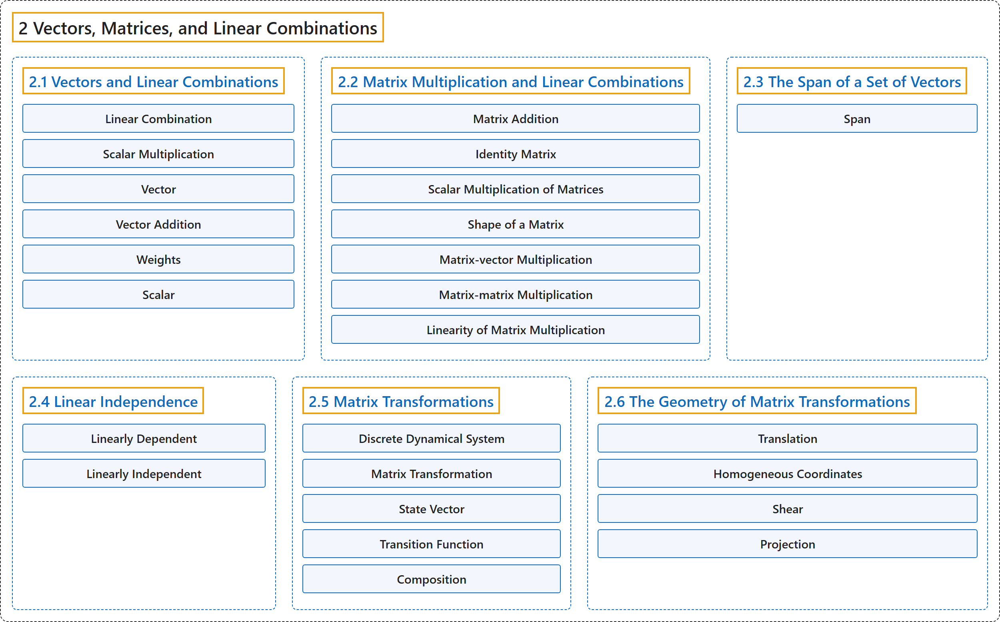

# 2 Vectors, Matrices, and Linear Combinations

## Classification

## Glossary

| Term | Definition | 中文翻译 | Source |
|---|---|---|---|
| **2 Vectors, Matrices, and Linear Combinations** 向量、矩阵与线性组合 | (No definition) | （无定义） | [Austin, 2023, chapter 2](https://understandinglinearalgebra.org/chap2.html) |
| **[2.1 Vectors and Linear Combinations](2-1-vectors-and-linear-combinations.md)** 向量与线性组合 | (No definition) | （无定义） | [Austin, 2023, section 2.1](https://understandinglinearalgebra.org/sec-vectors-lin-combs.html) |
| **[2.2 Matrix Multiplication and Linear Combinations](2-2-matrix-multiplication-and-linear-combinations.md)** 矩阵乘法与线性组合 | (No definition) | （无定义） | [Austin, 2023, section 2.2](https://understandinglinearalgebra.org/sec-matrices-lin-combs.html) |
| **[2.3 The Span of a Set of Vectors](2-3-the-span-of-a-set-of-vectors.md)** 向量组的张成 | (No definition) | （无定义） | [Austin, 2023, section 2.3](https://understandinglinearalgebra.org/sec-span.html) |
| **[2.4 Linear Independence](2-4-linear-independence.md)** 线性无关 | (No definition) | （无定义） | [Austin, 2023, section 2.4](https://understandinglinearalgebra.org/sec-linear-dep.html) |
| **[2.5 Matrix Transformations](2-5-matrix-transformations.md)** 矩阵变换 | (No definition) | （无定义） | [Austin, 2023, section 2.5](https://understandinglinearalgebra.org/sec-linear-trans.html) |
| **[2.6 The Geometry of Matrix Transformations](2-6-the-geometry-of-matrix-transformations.md)** 矩阵变换的几何 | (No definition) | （无定义） | [Austin, 2023, section 2.6](https://understandinglinearalgebra.org/sec-transforms-geom.html) |

## References

Austin, D. (2023). *Understanding linear algebra* (2023 update). Retrieved October 29, 2026, from <https://understandinglinearalgebra.org/home.html>
